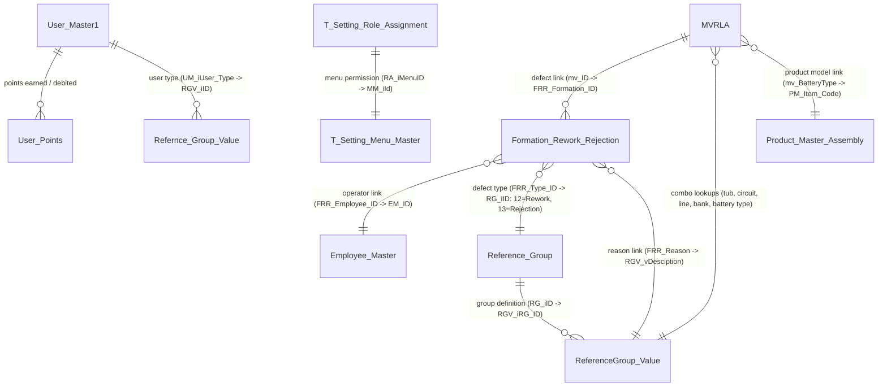

# AMARA RAJA BATTERIES – SBLT2 / MVRLA FORMATION TRACEABILITY
# MASTER CONSOLIDATED SPECIFICATION: REVERSE-ENGINEERING ANALYSIS & CLEAN ARCHITECTURE MIGRATION PLAN

> **DOCUMENT TYPE:** Master Consolidated Specification & Migration Blueprint  
> **PROJECT:** Amara Raja Batteries – SBLT2 / MVRLA Formation Traceability  
> **OLD PLATFORM:** ASP.NET MVC 4.8 / ADO.NET / JQWidgets / Crystal Reports (`d:\office\MVRLA_Formation\MVRLA_Formation\SBLT2`)  
> **TARGET PLATFORM:** .NET 8 Web API (Clean Architecture + Dapper) + React 18+ (Vite + Modular Vanilla CSS)  
> **DATABASE:** Existing Microsoft SQL Server Database (`Amaron2_Web_Assembly`) – Reused & Preserved (Zero schema alterations)  
> **STATUS:** Complete Read-Only Analysis & Architectural Blueprint  

---

## TABLE OF CONTENTS
1. [EXECUTIVE SUMMARY & SYSTEM METRICS](#part-i-executive-summary--verified-system-metrics)
2. [PART I: COMPLETE OLD PROJECT & DATABASE ANALYSIS](#part-ii-complete-old-project--database-analysis)
   - [1. Old Project Architectural Audit](#1-old-project-architectural-audit)
   - [2. Frontend Technology & View Audit](#2-frontend-technology--view-audit)
   - [3. MVC Controller & Action Audit](#3-mvc-controller--action-audit)
   - [4. Master Data Modules](#4-master-data-modules)
   - [5. Transaction Modules (MVRLA & Defect Logging)](#5-transaction-modules)
   - [6. Reports Suite Audit](#6-reports-suite-audit)
   - [7. Settings & Security Audit](#7-settings--security-audit)
   - [8. Authentication & Login Mechanism](#8-authentication--login-mechanism)
   - [9. Role-Based Navigation & Menu System](#9-role-based-navigation--menu-system)
   - [10. Complete Database Catalog (77 Tables)](#10-complete-database-catalog-77-tables)
   - [11. Database Classification (Active vs Legacy vs Orphan)](#11-database-classification)
   - [12. Stored Procedure Catalog & Active Audit (637 SPs)](#12-stored-procedure-catalog--active-audit)
   - [13. Database Scalar Functions (15 Functions)](#13-database-scalar-functions)
   - [14. Hardware & Printing Integrations (Barcode/QR)](#14-hardware--printing-integrations)
   - [15. Core Business Rules Inventory](#15-core-business-rules-inventory)
3. [PART II: OLD TO NEW MIGRATION MAPPING](#part-iii-old-to-new-migration-mapping)
   - [16. Clean Architecture Target Architecture](#16-clean-architecture-target-architecture)
   - [17. Technology Replacement Matrix](#17-technology-replacement-matrix)
   - [18. End-to-End Traceability Matrix](#18-end-to-end-traceability-matrix)
   - [19. Retired Legacy Modules (Do Not Migrate)](#19-retired-legacy-modules)
   - [20. Phased Migration Roadmap](#20-phased-migration-roadmap)
4. [PART III: .NET 8 WEB API CLEAN ARCHITECTURE SPECIFICATION](#part-iv-net-8-web-api-clean-architecture-specification)
   - [21. Solution & Project Structure](#21-solution--project-structure)
   - [22. REST API Endpoint Catalog & DTO Models](#22-rest-api-endpoint-catalog--dto-models)
   - [23. Dapper Repository Implementations](#23-dapper-repository-implementations)
   - [24. QuestPDF Export Engine Specification](#24-questpdf-export-engine-specification)
5. [PART IV: REACT + VITE SPA FRONTEND SPECIFICATION](#part-v-react--vite-spa-frontend-specification)
   - [25. Modern SPA Directory Layout](#25-modern-spa-directory-layout)
   - [26. Modular Vanilla CSS Design System Tokens](#26-modular-vanilla-css-design-system-tokens)
   - [27. Core Page Transformations & Component Specifications](#27-core-page-transformations--component-specifications)
   - [28. Axios Interceptors & State Management](#28-axios-interceptors--state-management)

---

# PART I: EXECUTIVE SUMMARY & VERIFIED SYSTEM METRICS

### 1. Old Project Metrics (Verified Codebase Evidence)
- **MVC Controllers:** **8 files** (6 MVC Controllers + 2 Utility classes)
- **MVC Controller Actions:** **378 actions**
  - `MasterController`: 172 actions
  - `TransactionController`: 83 actions
  - `ReportsController`: 51 actions
  - `SettingController`: 45 actions
  - `HomeController`: 26 actions
  - `ReportController`: 1 action
- **Frontend Views (.cshtml):** **50 views**
- **JavaScript Files:** **479 files** (mostly legacy third-party vendor libraries)
- **CSS Stylesheets:** **173 files**
- **Unique View AJAX Endpoints:** **66 unique endpoints** (81 call sites)
- **CommonData Handler Endpoints:** **100 endpoints** (`CommonData/getdata.aspx.cs` - 3,966 lines)
- **Master Modules:** **7 in code** (4 Active in DB, 3 Legacy)
- **Transaction Modules:** **11 in code** (2 Active Core, 9 Inactive Copied)
- **Report Modules:** **14 in code** (3 Active Core, 11 Inactive Copied)
- **Settings Modules:** **7 in code**

### 2. Database Metrics (Live SQL Server: `Amaron2_Web_Assembly`)
- **Total Tables:** **77 tables**
  - Active / Operational: **19 tables** (`MVRLA`, `Formation_Rework_Rejection`, `Product_Master_Assembly`, `User_Master1`, `Employee_Master`, `Reference_Group`, `ReferenceGroup_Value`, `Refernce_Group_Value`, `T_Setting_Menu_Master`, `T_Setting_Role_Assignment`, etc.)
  - Legacy / Past Lines: **29 tables** (Pasting, Curing, Grid casting)
  - Empty: **16 tables**
  - Orphan: **3 tables**
  - Telemetry / Large Historical Logs: **10 tables** (e.g. `AR_Traceability` with 951,812 rows)
- **Total Stored Procedures:** **637 stored procedures**
  - Active / Directly Called in Code: **97 SPs**
  - Internal SPs Called by Active SPs: **9 SPs**
  - Legacy / Inactive SPs: **531 SPs**
- **Scalar Lookup Functions:** **15 functions**
- **Database Views:** **0 views**
- **Database Triggers:** **0 triggers**
- **Physical Foreign Keys:** **0 constraints** (Relational integrity enforced by SP/App logic)

---

# PART II: COMPLETE OLD PROJECT & DATABASE ANALYSIS

*Amara Raja Batteries – MVRLA Formation Traceability System (SBLT2)*

> **Document Type:** System Reverse-Engineering & Database Deep-Dive Specification  
> **Environment:** Read-Only Source Code & Live SQL Server Instance Inspection  
> **Database Inspected:** `Amaron2_Web_Assembly` on `LAPTOP-7KC3K6QQ\SA`  
> **Codebase Inspected:** `d:\office\MVRLA_Formation\MVRLA_Formation\SBLT2`  
> **Generated At:** 2026-10-15T11:51:32.870Z

---

## 1. Project Overview

The **Amara Raja Batteries MVRLA Formation (SBLT2)** system is an industrial manufacturing execution and quality traceability web application. Its primary operational purpose is to track lead-acid battery packs through the **MVRLA (Valve Regulated Lead Acid) Formation** process—including acid filling, charging/discharging, defect logging, rework/rejection workflows, and batch/skid traceability.
The codebase represents an evolved industrial solution developed by **Genuine IT Solution / SriPravanTech**. Reverse-engineering reveals that the project was originally built on top of a multi-purpose enterprise starter boilerplate (which previously housed warehouse tracking, bobbin tracking, and an internal prediction game), onto which the core **MVRLA Formation** process logic and **Rework/Rejection** modules were integrated.

## 2. Existing Technology Stack

| Layer | Technology / Framework | Details / Notes |
| :--- | :--- | :--- |
| **Web Framework** | ASP.NET MVC 4.0 / 5.2 | Targeting .NET Framework 4.8 / 4.5 runtime (`Web.config`) |
| **Web Server Handler** | ASP.NET Web Forms / Ashx style | `CommonData/getdata.aspx.cs` serves as a generic AJAX endpoint dispatcher |
| **Data Access Layer** | ADO.NET (Raw `System.Data.SqlClient`) | Uses helper class `SriPravanTech.dbFunctions` (`SqlConnection`, `SqlCommand`, `SqlDataAdapter`, `DataTable`) |
| **ORM / Models** | None (Schema-less DataTable approach) | The `Models/` directory is empty; queries dynamically populate `DataTable` and custom JSON strings |
| **Database Engine** | Microsoft SQL Server | Instance `LAPTOP-7KC3K6QQ\SA`, Database `Amaron2_Web_Assembly` |
| **Client-Side Framework** | jQuery 2.1.1 & jQuery UI | Extensive DOM manipulation, AJAX data binding |
| **UI Component Library** | JQWidgets (jqx-all.js, jqxcore.js) | `jqxDataAdapter`, `jqxGrid`, dropdown controls |
| **CSS Framework** | Materialize CSS + AdminLTE 2.0 / Bootstrap 3 | Mixed CSS styling: Materialize form inputs with AdminLTE sidebar layout |
| **Reporting / Export** | SAP Crystal Reports + iTextSharp / PDF | `CrystalDecisions.CrystalReports.Engine` (`PayslipCrystal/*.rpt`) |
| **Barcode / QR Engine** | QRCoder & GenCode128 | Generates Code128 barcodes and 2D QR codes for battery skid tracking |
| **Client Storage** | HTML5 `sessionStorage` | Stores login user (`user`), role permissions (`rights`), user ID (`User_ID`), and HTML menu (`Menu`) |

## 3. Existing Database Name

- **Database Name:** `Amaron2_Web_Assembly`
- **SQL Server Instance:** `LAPTOP-7KC3K6QQ\SA`
- **Database Collation:** `SQL_Latin1_General_CP1_CI_AS`

## 4. Connection Information Summary

> [!NOTE]
> In compliance with security standards, all sensitive passwords and credentials have been redacted.

```xml
<!-- Active Connection String in SBLT2/Web.config (Line 10) -->
<add key="ConStr" value="Data Source=LAPTOP-7KC3K6QQ\SA;Initial Catalog=Amaron2_Web_Assembly;Persist Security Info=True;User ID=sa;Password=[REDACTED]"/>

<!-- Commented Historical Connection Strings in Web.config -->
<!-- <add key="ConStr" value="Data Source=XAVI-PC;Initial Catalog=ABD_BOBBIN;User ID=sa;Password=[REDACTED]" /> -->
<!-- <add key="ConStr" value="Data Source=DESKTOP-TPLSMM1;Initial Catalog=Vendor_Managements;User ID=sa;Password=[REDACTED]" /> -->
<!-- <add key="ConStr" value="Data Source=vino-pc;Initial Catalog=SBLT1;User ID=sa;Password=[REDACTED]" /> -->
```

## 5. Complete Table Inventory

The SQL Server database `Amaron2_Web_Assembly` contains exactly **77 tables**. Below is the complete, exhaustive catalog verified against `sys.tables`, `sys.partitions`, and `INFORMATION_SCHEMA.COLUMNS`:

| Table Name | Row Count | Columns | Primary Key | Classification | Evidence / Basis |
| :--- | :-: | :-: | :--- | :--- | :--- |
| `AR_Assembly_Skid_Handle` | 474 | 6 | `None (No PK)` | **UNKNOWN / REQUIRES VERIFICATION** | Has 474 rows. No direct code references, no SP references. May be external/background process. |
| `AR_Formationunload_Skid_Handle` | 495 | 6 | `None (No PK)` | **UNKNOWN / REQUIRES VERIFICATION** | Has 495 rows. No direct code references, no SP references. May be external/background process. |
| `AR_Traceability` | 951,812 | 75 | `None (No PK)` | **UNKNOWN / REQUIRES VERIFICATION** | Has 951812 rows. No direct code references, no SP references. May be external/background process. |
| `Assembly_Al_Rework_Rejection` | 0 | 13 | `None (No PK)` | **ORPHAN / NO CLEAR REFERENCE** | 0 rows. No code references, no stored procedure references. |
| `Assembly_IN` | 0 | 23 | `Row_Id` | **EMPTY TABLE** | 0 rows. Referenced by 11 inactive SP(s), but 0 active references. |
| `Assembly_Rework_Process` | 0 | 24 | `Row_Id` | **EMPTY TABLE** | 0 rows. Referenced by 10 inactive SP(s), but 0 active references. |
| `Assembly_Rework_Rejection` | 700 | 15 | `Row_Id` | **LEGACY / POSSIBLY UNUSED TABLE** | Has 700 rows, referenced by 2 SP(s), but neither table nor those SPs are referenced in old project code. |
| `BATTERY_CHARGING_TUBS_MASTER` | 1,603 | 8 | `ID` | **UNKNOWN / REQUIRES VERIFICATION** | Has 1603 rows. No direct code references, no SP references. May be external/background process. |
| `BATTERY_MASTER` | 923 | 6 | `Row_Id` | **LEGACY / POSSIBLY UNUSED TABLE** | Has 923 rows, referenced by 6 SP(s), but neither table nor those SPs are referenced in old project code. |
| `boch_data` | 0 | 2 | `None (No PK)` | **EMPTY TABLE** | 0 rows. Referenced by 1 inactive SP(s), but 0 active references. |
| `Company_Master` | 1 | 22 | `CM_ID` | **ACTIVE / WORKING TABLE** | Referenced by 0 code file(s) and/or 5 active SP(s). Row count: 1. |
| `Customer_Master` | 3 | 18 | `CM_Id` | **ACTIVE / WORKING TABLE** | Referenced by 0 code file(s) and/or 2 active SP(s). Row count: 3. |
| `Employee_Master` | 21 | 11 | `EM_ID` | **ACTIVE / WORKING TABLE** | Referenced by 2 code file(s) and/or 4 active SP(s). Row count: 21. |
| `Employee_Master_Ass` | 106 | 8 | `EM_iID` | **LEGACY / POSSIBLY UNUSED TABLE** | Has 106 rows, referenced by 4 SP(s), but neither table nor those SPs are referenced in old project code. |
| `Finished_Inventory` | 11 | 15 | `None (No PK)` | **LEGACY / POSSIBLY UNUSED TABLE** | Has 11 rows, referenced by 1 SP(s), but neither table nor those SPs are referenced in old project code. |
| `Formation_Rework_Rejection` | 13 | 10 | `FRR_ID` | **ACTIVE / WORKING TABLE** | Referenced by 0 code file(s) and/or 6 active SP(s). Row count: 13. |
| `Grid_Inventory_Rework_Process` | 1 | 18 | `Trans_Id` | **LEGACY / POSSIBLY UNUSED TABLE** | Has 1 rows, referenced by 2 SP(s), but neither table nor those SPs are referenced in old project code. |
| `Grid_Segregation_Details` | 0 | 21 | `ID` | **EMPTY TABLE** | 0 rows. Referenced by 4 inactive SP(s), but 0 active references. |
| `Grid_Segregation_Main` | 0 | 12 | `ID` | **EMPTY TABLE** | 0 rows. Referenced by 2 inactive SP(s), but 0 active references. |
| `Gride_Casting_Process` | 8,657 | 30 | `GC_Trans_ID` | **LEGACY / POSSIBLY UNUSED TABLE** | Has 8657 rows, referenced by 37 SP(s), but neither table nor those SPs are referenced in old project code. |
| `Inventory_Process` | 7,757 | 38 | `II_Trans_ID` | **LEGACY / POSSIBLY UNUSED TABLE** | Has 7757 rows, referenced by 29 SP(s), but neither table nor those SPs are referenced in old project code. |
| `Line_` | 0 | 1 | `None (No PK)` | **EMPTY TABLE** | 0 rows. Referenced by 1 inactive SP(s), but 0 active references. |
| `Link_Battery_Master_Plate_Master` | 918 | 10 | `Row_Id` | **LEGACY / POSSIBLY UNUSED TABLE** | Has 918 rows, referenced by 7 SP(s), but neither table nor those SPs are referenced in old project code. |
| `LogoPage` | 0 | 7 | `None (No PK)` | **EMPTY TABLE** | 0 rows currently, but active references in code (2) and/or active SPs (5). Likely staging/log/transaction. |
| `Machine_Master` | 33 | 8 | `None (No PK)` | **ACTIVE / WORKING TABLE** | Referenced by 0 code file(s) and/or 5 active SP(s). Row count: 33. |
| `Mold_Master` | 129 | 7 | `MM_ID` | **LEGACY / POSSIBLY UNUSED TABLE** | Has 129 rows, referenced by 8 SP(s), but neither table nor those SPs are referenced in old project code. |
| `MVRLA` | 14,898 | 27 | `mv_ID` | **ACTIVE / WORKING TABLE** | Referenced by 4 code file(s) and/or 11 active SP(s). Row count: 14898. |
| `Old_Data` | 0 | 2 | `None (No PK)` | **ORPHAN / NO CLEAR REFERENCE** | 0 rows. No code references, no stored procedure references. |
| `Part_Assign_To_Mold` | 145 | 10 | `Row_Id` | **UNKNOWN / REQUIRES VERIFICATION** | Has 145 rows. No direct code references, no SP references. May be external/background process. |
| `Pasting_Inventory_Process` | 1,590 | 40 | `Row_Id` | **LEGACY / POSSIBLY UNUSED TABLE** | Has 1590 rows, referenced by 13 SP(s), but neither table nor those SPs are referenced in old project code. |
| `Pasting_Inventory_Process_Retuen_Details` | 1 | 28 | `Row_Id` | **LEGACY / POSSIBLY UNUSED TABLE** | Has 1 rows, referenced by 3 SP(s), but neither table nor those SPs are referenced in old project code. |
| `Pasting_Inventory_Rework` | 11 | 35 | `Row_Id` | **LEGACY / POSSIBLY UNUSED TABLE** | Has 11 rows, referenced by 3 SP(s), but neither table nor those SPs are referenced in old project code. |
| `Pasting_Inventory_Segregation_Details` | 0 | 21 | `ID` | **EMPTY TABLE** | 0 rows. Referenced by 5 inactive SP(s), but 0 active references. |
| `Pasting_Inventory_Segregation_Main` | 0 | 13 | `ID` | **EMPTY TABLE** | 0 rows. Referenced by 3 inactive SP(s), but 0 active references. |
| `Pasting_Plate_collection` | 4,104 | 24 | `Row_Id` | **LEGACY / POSSIBLY UNUSED TABLE** | Has 4104 rows, referenced by 19 SP(s), but neither table nor those SPs are referenced in old project code. |
| `Pasting_Process` | 7,103 | 50 | `WIP_Trans_Id` | **LEGACY / POSSIBLY UNUSED TABLE** | Has 7103 rows, referenced by 21 SP(s), but neither table nor those SPs are referenced in old project code. |
| `Pasting_Re_Work_Process` | 0 | 39 | `WIP_Trans_Id` | **EMPTY TABLE** | 0 rows. Referenced by 2 inactive SP(s), but 0 active references. |
| `Plate_Stand_Master` | 1,246 | 7 | `None (No PK)` | **LEGACY / POSSIBLY UNUSED TABLE** | Has 1246 rows, referenced by 8 SP(s), but neither table nor those SPs are referenced in old project code. |
| `Plates_Curing_Ovens_In_Out` | 3,659 | 33 | `Row_Id` | **LEGACY / POSSIBLY UNUSED TABLE** | Has 3659 rows, referenced by 12 SP(s), but neither table nor those SPs are referenced in old project code. |
| `PLATES_MASTER` | 57 | 9 | `Row_Id` | **LEGACY / POSSIBLY UNUSED TABLE** | Has 57 rows, referenced by 7 SP(s), but neither table nor those SPs are referenced in old project code. |
| `Plates_Type_Master` | 43 | 10 | `Plate_Id` | **LEGACY / POSSIBLY UNUSED TABLE** | Has 43 rows, referenced by 14 SP(s), but neither table nor those SPs are referenced in old project code. |
| `PLP_Grid_Casting` | 0 | 41 | `None (No PK)` | **EMPTY TABLE** | 0 rows. Referenced by 2 inactive SP(s), but 0 active references. |
| `PLP_Strip_Casting` | 0 | 41 | `None (No PK)` | **EMPTY TABLE** | 0 rows. Referenced by 3 inactive SP(s), but 0 active references. |
| `PRN_File` | 1 | 6 | `PF_ID` | **LEGACY / POSSIBLY UNUSED TABLE** | Has 1 rows, referenced by 1 SP(s), but neither table nor those SPs are referenced in old project code. |
| `Product_Master` | 28 | 22 | `PM_IID, PM_Part_Number` | **ACTIVE / WORKING TABLE** | Referenced by 0 code file(s) and/or 2 active SP(s). Row count: 28. |
| `Product_Master_Assembly` | 1,276 | 17 | `PM_iID` | **ACTIVE / WORKING TABLE** | Referenced by 1 code file(s) and/or 0 active SP(s). Row count: 1276. |
| `Product_Master_Assembly_Old` | 1,129 | 16 | `PM_iID` | **LEGACY / POSSIBLY UNUSED TABLE** | Name matches backup/duplicate pattern. 0 active SPs, 0 code references. Row count: 1129. |
| `Rack_Master` | 0 | 6 | `RR_ID` | **ORPHAN / NO CLEAR REFERENCE** | 0 rows. No code references, no stored procedure references. |
| `Reference_Group` | 13 | 6 | `RG_iID` | **ACTIVE / WORKING TABLE** | Referenced by 1 code file(s) and/or 4 active SP(s). Row count: 13. |
| `ReferenceGroup_Value` | 27 | 7 | `RGV_iID` | **ACTIVE / WORKING TABLE** | Referenced by 0 code file(s) and/or 16 active SP(s). Row count: 27. |
| `Refernce_Group_Value` | 6 | 7 | `RGV_iID` | **ACTIVE / WORKING TABLE** | Referenced by 0 code file(s) and/or 4 active SP(s). Row count: 6. |
| `S_Grid_Setting` | 437 | 11 | `GS_ID` | **LEGACY / POSSIBLY UNUSED TABLE** | Has 437 rows, referenced by 2 SP(s), but neither table nor those SPs are referenced in old project code. |
| `S_Menu_Master` | 147 | 11 | `MM_ID` | **LEGACY / POSSIBLY UNUSED TABLE** | Has 147 rows, referenced by 10 SP(s), but neither table nor those SPs are referenced in old project code. |
| `S_Rights_Master` | 601 | 10 | `RA_ID` | **LEGACY / POSSIBLY UNUSED TABLE** | Has 601 rows, referenced by 4 SP(s), but neither table nor those SPs are referenced in old project code. |
| `S_Style_Setting` | 2 | 14 | `None (No PK)` | **LEGACY / POSSIBLY UNUSED TABLE** | Has 2 rows, referenced by 2 SP(s), but neither table nor those SPs are referenced in old project code. |
| `Scan_Details` | 0 | 20 | `SD_ID` | **EMPTY TABLE** | 0 rows. Referenced by 9 inactive SP(s), but 0 active references. |
| `ScanErrorLog_batterycount` | 50 | 3 | `None (No PK)` | **UNKNOWN / REQUIRES VERIFICATION** | Has 50 rows. No direct code references, no SP references. May be external/background process. |
| `ScanErrorLog_DBError` | 50 | 4 | `None (No PK)` | **UNKNOWN / REQUIRES VERIFICATION** | Has 50 rows. No direct code references, no SP references. May be external/background process. |
| `ScanErrorLog_ScanError` | 50 | 3 | `None (No PK)` | **UNKNOWN / REQUIRES VERIFICATION** | Has 50 rows. No direct code references, no SP references. May be external/background process. |
| `ScanErrorMessage` | 1,707 | 5 | `None (No PK)` | **UNKNOWN / REQUIRES VERIFICATION** | Has 1707 rows. No direct code references, no SP references. May be external/background process. |
| `SEGREGATION_Rework_Details` | 1 | 21 | `ID` | **LEGACY / POSSIBLY UNUSED TABLE** | Has 1 rows, referenced by 2 SP(s), but neither table nor those SPs are referenced in old project code. |
| `Segregation_Rework_Main` | 1 | 11 | `ID` | **LEGACY / POSSIBLY UNUSED TABLE** | Has 1 rows, referenced by 2 SP(s), but neither table nor those SPs are referenced in old project code. |
| `Sheet1$` | 18,508 | 14 | `None (No PK)` | **UNKNOWN / REQUIRES VERIFICATION** | Has 18508 rows. No direct code references, no SP references. May be external/background process. |
| `shift_` | 0 | 1 | `None (No PK)` | **EMPTY TABLE** | 0 rows. Referenced by 1 inactive SP(s), but 0 active references. |
| `Skid_Master` | 986 | 8 | `SKM_ID` | **LEGACY / POSSIBLY UNUSED TABLE** | Has 986 rows, referenced by 11 SP(s), but neither table nor those SPs are referenced in old project code. |
| `Store_Master` | 29 | 5 | `ST_Id` | **LEGACY / POSSIBLY UNUSED TABLE** | Has 29 rows, referenced by 6 SP(s), but neither table nor those SPs are referenced in old project code. |
| `Supplier_Master` | 56 | 21 | `SM_Id` | **ACTIVE / WORKING TABLE** | Referenced by 2 code file(s) and/or 3 active SP(s). Row count: 56. |
| `sysdiagrams` | 0 | 5 | `diagram_id, principal_id, name` | **EMPTY TABLE** | 0 rows. Referenced by 7 inactive SP(s), but 0 active references. |
| `T_Setting_Menu_Master` | 87 | 14 | `MM_iId` | **ACTIVE / WORKING TABLE** | Referenced by 0 code file(s) and/or 10 active SP(s). Row count: 87. |
| `T_Setting_Role_Assignment` | 134 | 14 | `RA_iID` | **ACTIVE / WORKING TABLE** | Referenced by 0 code file(s) and/or 7 active SP(s). Row count: 134. |
| `T_Setting_UserMaster` | 9 | 8 | `UM_vUser_Name` | **ACTIVE / WORKING TABLE** | Referenced by 0 code file(s) and/or 5 active SP(s). Row count: 9. |
| `T_Settings_Modules` | 2 | 11 | `MD_iid` | **ACTIVE / WORKING TABLE** | Referenced by 0 code file(s) and/or 1 active SP(s). Row count: 2. |
| `Tax_Master` | 0 | 16 | `None (No PK)` | **EMPTY TABLE** | 0 rows. Referenced by 5 inactive SP(s), but 0 active references. |
| `User_Master` | 25 | 9 | `UM_ID, UM_User_Name` | **ACTIVE / WORKING TABLE** | Referenced by 6 code file(s) and/or 5 active SP(s). Row count: 25. |
| `User_Master1` | 64 | 15 | `None (No PK)` | **ACTIVE / WORKING TABLE** | Referenced by 0 code file(s) and/or 3 active SP(s). Row count: 64. |
| `User_Points` | 1 | 24 | `Up_ID` | **ACTIVE / WORKING TABLE** | Referenced by 0 code file(s) and/or 3 active SP(s). Row count: 1. |
| `WIP_IN_Process` | 8,209 | 34 | `WIP_Trans_Id` | **LEGACY / POSSIBLY UNUSED TABLE** | Has 8209 rows, referenced by 30 SP(s), but neither table nor those SPs are referenced in old project code. |

## 6. Table Classification & Criteria

Every table has been classified strictly based on code references, SP definitions, active controller usage, and actual row count data:

### ACTIVE / WORKING TABLE (19 Tables)

| Table Name | Row Count | Evidence / Justification |
| :--- | :-: | :--- |
| `Company_Master` | 1 | Referenced by 0 code file(s) and/or 5 active SP(s). Row count: 1. |
| `Customer_Master` | 3 | Referenced by 0 code file(s) and/or 2 active SP(s). Row count: 3. |
| `Employee_Master` | 21 | Referenced by 2 code file(s) and/or 4 active SP(s). Row count: 21. |
| `Formation_Rework_Rejection` | 13 | Referenced by 0 code file(s) and/or 6 active SP(s). Row count: 13. |
| `Machine_Master` | 33 | Referenced by 0 code file(s) and/or 5 active SP(s). Row count: 33. |
| `MVRLA` | 14,898 | Referenced by 4 code file(s) and/or 11 active SP(s). Row count: 14898. |
| `Product_Master` | 28 | Referenced by 0 code file(s) and/or 2 active SP(s). Row count: 28. |
| `Product_Master_Assembly` | 1,276 | Referenced by 1 code file(s) and/or 0 active SP(s). Row count: 1276. |
| `Reference_Group` | 13 | Referenced by 1 code file(s) and/or 4 active SP(s). Row count: 13. |
| `ReferenceGroup_Value` | 27 | Referenced by 0 code file(s) and/or 16 active SP(s). Row count: 27. |
| `Refernce_Group_Value` | 6 | Referenced by 0 code file(s) and/or 4 active SP(s). Row count: 6. |
| `Supplier_Master` | 56 | Referenced by 2 code file(s) and/or 3 active SP(s). Row count: 56. |
| `T_Setting_Menu_Master` | 87 | Referenced by 0 code file(s) and/or 10 active SP(s). Row count: 87. |
| `T_Setting_Role_Assignment` | 134 | Referenced by 0 code file(s) and/or 7 active SP(s). Row count: 134. |
| `T_Setting_UserMaster` | 9 | Referenced by 0 code file(s) and/or 5 active SP(s). Row count: 9. |
| `T_Settings_Modules` | 2 | Referenced by 0 code file(s) and/or 1 active SP(s). Row count: 2. |
| `User_Master` | 25 | Referenced by 6 code file(s) and/or 5 active SP(s). Row count: 25. |
| `User_Master1` | 64 | Referenced by 0 code file(s) and/or 3 active SP(s). Row count: 64. |
| `User_Points` | 1 | Referenced by 0 code file(s) and/or 3 active SP(s). Row count: 1. |

### LEGACY / POSSIBLY UNUSED TABLE (29 Tables)

| Table Name | Row Count | Evidence / Justification |
| :--- | :-: | :--- |
| `Assembly_Rework_Rejection` | 700 | Has 700 rows, referenced by 2 SP(s), but neither table nor those SPs are referenced in old project code. |
| `BATTERY_MASTER` | 923 | Has 923 rows, referenced by 6 SP(s), but neither table nor those SPs are referenced in old project code. |
| `Employee_Master_Ass` | 106 | Has 106 rows, referenced by 4 SP(s), but neither table nor those SPs are referenced in old project code. |
| `Finished_Inventory` | 11 | Has 11 rows, referenced by 1 SP(s), but neither table nor those SPs are referenced in old project code. |
| `Grid_Inventory_Rework_Process` | 1 | Has 1 rows, referenced by 2 SP(s), but neither table nor those SPs are referenced in old project code. |
| `Gride_Casting_Process` | 8,657 | Has 8657 rows, referenced by 37 SP(s), but neither table nor those SPs are referenced in old project code. |
| `Inventory_Process` | 7,757 | Has 7757 rows, referenced by 29 SP(s), but neither table nor those SPs are referenced in old project code. |
| `Link_Battery_Master_Plate_Master` | 918 | Has 918 rows, referenced by 7 SP(s), but neither table nor those SPs are referenced in old project code. |
| `Mold_Master` | 129 | Has 129 rows, referenced by 8 SP(s), but neither table nor those SPs are referenced in old project code. |
| `Pasting_Inventory_Process` | 1,590 | Has 1590 rows, referenced by 13 SP(s), but neither table nor those SPs are referenced in old project code. |
| `Pasting_Inventory_Process_Retuen_Details` | 1 | Has 1 rows, referenced by 3 SP(s), but neither table nor those SPs are referenced in old project code. |
| `Pasting_Inventory_Rework` | 11 | Has 11 rows, referenced by 3 SP(s), but neither table nor those SPs are referenced in old project code. |
| `Pasting_Plate_collection` | 4,104 | Has 4104 rows, referenced by 19 SP(s), but neither table nor those SPs are referenced in old project code. |
| `Pasting_Process` | 7,103 | Has 7103 rows, referenced by 21 SP(s), but neither table nor those SPs are referenced in old project code. |
| `Plate_Stand_Master` | 1,246 | Has 1246 rows, referenced by 8 SP(s), but neither table nor those SPs are referenced in old project code. |
| `Plates_Curing_Ovens_In_Out` | 3,659 | Has 3659 rows, referenced by 12 SP(s), but neither table nor those SPs are referenced in old project code. |
| `PLATES_MASTER` | 57 | Has 57 rows, referenced by 7 SP(s), but neither table nor those SPs are referenced in old project code. |
| `Plates_Type_Master` | 43 | Has 43 rows, referenced by 14 SP(s), but neither table nor those SPs are referenced in old project code. |
| `PRN_File` | 1 | Has 1 rows, referenced by 1 SP(s), but neither table nor those SPs are referenced in old project code. |
| `Product_Master_Assembly_Old` | 1,129 | Name matches backup/duplicate pattern. 0 active SPs, 0 code references. Row count: 1129. |
| `S_Grid_Setting` | 437 | Has 437 rows, referenced by 2 SP(s), but neither table nor those SPs are referenced in old project code. |
| `S_Menu_Master` | 147 | Has 147 rows, referenced by 10 SP(s), but neither table nor those SPs are referenced in old project code. |
| `S_Rights_Master` | 601 | Has 601 rows, referenced by 4 SP(s), but neither table nor those SPs are referenced in old project code. |
| `S_Style_Setting` | 2 | Has 2 rows, referenced by 2 SP(s), but neither table nor those SPs are referenced in old project code. |
| `SEGREGATION_Rework_Details` | 1 | Has 1 rows, referenced by 2 SP(s), but neither table nor those SPs are referenced in old project code. |
| `Segregation_Rework_Main` | 1 | Has 1 rows, referenced by 2 SP(s), but neither table nor those SPs are referenced in old project code. |
| `Skid_Master` | 986 | Has 986 rows, referenced by 11 SP(s), but neither table nor those SPs are referenced in old project code. |
| `Store_Master` | 29 | Has 29 rows, referenced by 6 SP(s), but neither table nor those SPs are referenced in old project code. |
| `WIP_IN_Process` | 8,209 | Has 8209 rows, referenced by 30 SP(s), but neither table nor those SPs are referenced in old project code. |

### EMPTY TABLE (16 Tables)

| Table Name | Row Count | Evidence / Justification |
| :--- | :-: | :--- |
| `Assembly_IN` | 0 | 0 rows. Referenced by 11 inactive SP(s), but 0 active references. |
| `Assembly_Rework_Process` | 0 | 0 rows. Referenced by 10 inactive SP(s), but 0 active references. |
| `boch_data` | 0 | 0 rows. Referenced by 1 inactive SP(s), but 0 active references. |
| `Grid_Segregation_Details` | 0 | 0 rows. Referenced by 4 inactive SP(s), but 0 active references. |
| `Grid_Segregation_Main` | 0 | 0 rows. Referenced by 2 inactive SP(s), but 0 active references. |
| `Line_` | 0 | 0 rows. Referenced by 1 inactive SP(s), but 0 active references. |
| `LogoPage` | 0 | 0 rows currently, but active references in code (2) and/or active SPs (5). Likely staging/log/transaction. |
| `Pasting_Inventory_Segregation_Details` | 0 | 0 rows. Referenced by 5 inactive SP(s), but 0 active references. |
| `Pasting_Inventory_Segregation_Main` | 0 | 0 rows. Referenced by 3 inactive SP(s), but 0 active references. |
| `Pasting_Re_Work_Process` | 0 | 0 rows. Referenced by 2 inactive SP(s), but 0 active references. |
| `PLP_Grid_Casting` | 0 | 0 rows. Referenced by 2 inactive SP(s), but 0 active references. |
| `PLP_Strip_Casting` | 0 | 0 rows. Referenced by 3 inactive SP(s), but 0 active references. |
| `Scan_Details` | 0 | 0 rows. Referenced by 9 inactive SP(s), but 0 active references. |
| `shift_` | 0 | 0 rows. Referenced by 1 inactive SP(s), but 0 active references. |
| `sysdiagrams` | 0 | 0 rows. Referenced by 7 inactive SP(s), but 0 active references. |
| `Tax_Master` | 0 | 0 rows. Referenced by 5 inactive SP(s), but 0 active references. |

### ORPHAN / NO CLEAR REFERENCE (3 Tables)

| Table Name | Row Count | Evidence / Justification |
| :--- | :-: | :--- |
| `Assembly_Al_Rework_Rejection` | 0 | 0 rows. No code references, no stored procedure references. |
| `Old_Data` | 0 | 0 rows. No code references, no stored procedure references. |
| `Rack_Master` | 0 | 0 rows. No code references, no stored procedure references. |

### UNKNOWN / REQUIRES VERIFICATION (10 Tables)

| Table Name | Row Count | Evidence / Justification |
| :--- | :-: | :--- |
| `AR_Assembly_Skid_Handle` | 474 | Has 474 rows. No direct code references, no SP references. May be external/background process. |
| `AR_Formationunload_Skid_Handle` | 495 | Has 495 rows. No direct code references, no SP references. May be external/background process. |
| `AR_Traceability` | 951,812 | Has 951812 rows. No direct code references, no SP references. May be external/background process. |
| `BATTERY_CHARGING_TUBS_MASTER` | 1,603 | Has 1603 rows. No direct code references, no SP references. May be external/background process. |
| `Part_Assign_To_Mold` | 145 | Has 145 rows. No direct code references, no SP references. May be external/background process. |
| `ScanErrorLog_batterycount` | 50 | Has 50 rows. No direct code references, no SP references. May be external/background process. |
| `ScanErrorLog_DBError` | 50 | Has 50 rows. No direct code references, no SP references. May be external/background process. |
| `ScanErrorLog_ScanError` | 50 | Has 50 rows. No direct code references, no SP references. May be external/background process. |
| `ScanErrorMessage` | 1,707 | Has 1707 rows. No direct code references, no SP references. May be external/background process. |
| `Sheet1$` | 18,508 | Has 18508 rows. No direct code references, no SP references. May be external/background process. |

## 7. Stored Procedure Analysis

The database contains **637 stored procedures**. Analysis reveals that **97 SPs** are actively and directly referenced in the existing project code, **9 SPs** are internal procedures called by other procedures, and **531 SPs** are legacy/unused procedures inherited from older systems.

### Active / Referenced Stored Procedures in Old Project Code (106 Procedures)

| Procedure Name | Parameters | Tables Referenced | Operations | Code Reference(s) | Status |
| :--- | :--- | :--- | :--- | :--- | :--- |
| `Fetch_Rejection_ChartWeb` | `undefined (undefined(50))` | *None / System* | SELECT | *Called by other SP* | **UNKNOWN / CALLED BY OTHER SP** |
| `Fetch_TypeWiseProd_Line1_ChartWeb` | `undefined (undefined(50))` | *None / System* | SELECT | *Called by other SP* | **UNKNOWN / CALLED BY OTHER SP** |
| `Fin_Fetch_Linewise_ChartWeb` | `undefined (undefined(50))` | *None / System* | SELECT | *Called by other SP* | **UNKNOWN / CALLED BY OTHER SP** |
| `pr_checkQRCode` | `undefined (undefined(50))` | `MVRLA` | SELECT | `Controllers/TransactionController.cs` | **ACTIVE / REFERENCED** |
| `Pr_Delete_Company_Master` | `undefined (undefined)` | `Company_Master` | UPDATE | `CommonData/getdata.aspx.cs` | **ACTIVE / REFERENCED** |
| `Pr_Delete_Employee_Master` | `undefined (undefined)` | `Employee_Master` | UPDATE | `Controllers/MasterController.cs` | **ACTIVE / REFERENCED** |
| `Pr_Delete_Group_Master` | `undefined (undefined)` | *None / System* | UPDATE | `CommonData/getdata.aspx.cs` | **ACTIVE / REFERENCED** |
| `Pr_Delete_Item_Master` | `undefined (undefined)` | *None / System* | UPDATE | `CommonData/getdata.aspx.cs` | **ACTIVE / REFERENCED** |
| `Pr_delete_LogoPage` | `undefined (undefined)` | `LogoPage` | UPDATE | `Controllers/HomeController.cs`<br>`Views/Home/LogoPage.cshtml` | **ACTIVE / REFERENCED** |
| `Pr_Delete_Machine_Master` | `undefined (undefined)` | `Machine_Master` | UPDATE | `CommonData/getdata.aspx.cs` | **ACTIVE / REFERENCED** |
| `Pr_Delete_MVRLA` | `undefined (undefined(50))` | `MVRLA` | UPDATE | `Controllers/TransactionController.cs`<br>`Views/Transaction/MVRLA.cshtml` | **ACTIVE / REFERENCED** |
| `Pr_Delete_Reference_Master` | `undefined (undefined(50))` | `ReferenceGroup_Value` | UPDATE | `Controllers/MasterController.cs`<br>`Views/Master/Reference_Master.cshtml` | **ACTIVE / REFERENCED** |
| `Pr_Delete_Supplier_Master` | `undefined (undefined)` | `Supplier_Master` | UPDATE | `Controllers/MasterController.cs`<br>`Views/Master/Supplier_Master.cshtml` | **ACTIVE / REFERENCED** |
| `Pr_Delete_T_Setting_UserMaster` | `undefined (undefined)` | `T_Setting_UserMaster` | UPDATE | `Controllers/SettingController.cs`<br>`Views/Setting/User_Master.cshtml` | **ACTIVE / REFERENCED** |
| `Pr_Delete_User_Master` | `undefined (undefined)` | `User_Master` | UPDATE | `Controllers/MasterController.cs`<br>`Views/Master/User_Master.cshtml` | **ACTIVE / REFERENCED** |
| `pr_fetch_Active_Employees` | *None* | `Employee_Master` | SELECT | `Controllers/TransactionController.cs`<br>`Views/Transaction/Rework_Rejection.cshtml` | **ACTIVE / REFERENCED** |
| `pr_Fetch_Assembly_Rework` | `undefined (undefined(50))`<br>`undefined (undefined(50))`<br>`undefined (undefined(50))` | `Assembly_Rework_Rejection` | SELECT | *Called by other SP* | **UNKNOWN / CALLED BY OTHER SP** |
| `pr_fetch_BankNoCombos` | *None* | `ReferenceGroup_Value` | SELECT | `Controllers/TransactionController.cs`<br>`Views/Transaction/MVRLA.cshtml` | **ACTIVE / REFERENCED** |
| `pr_fetch_BatteryTypeCombos` | *None* | `ReferenceGroup_Value` | SELECT | `Controllers/TransactionController.cs`<br>`Views/Reports/Filling_Report.cshtml`<br>`Views/Transaction/MVRLA.cshtml` | **ACTIVE / REFERENCED** |
| `pr_fetch_CKTCombos` | *None* | `ReferenceGroup_Value` | SELECT | `Controllers/TransactionController.cs`<br>`Views/Transaction/MVRLA.cshtml` | **ACTIVE / REFERENCED** |
| `Pr_Fetch_Company_Master_ByID` | `undefined (undefined)` | `Company_Master` | SELECT | `CommonData/getdata.aspx.cs`<br>`Controllers/MasterController.cs` | **ACTIVE / REFERENCED** |
| `Pr_Fetch_Company_Master_Details` | *None* | `Company_Master` | SELECT | `CommonData/getdata.aspx.cs` | **ACTIVE / REFERENCED** |
| `Pr_Fetch_Employee_Master_Details` | *None* | `Employee_Master` | SELECT | `Controllers/MasterController.cs` | **ACTIVE / REFERENCED** |
| `pr_fetch_failedqty_chart` | *None* | `MVRLA` | SELECT | `Controllers/HomeController.cs`<br>`Views/Home/Dashboard.cshtml` | **ACTIVE / REFERENCED** |
| `Pr_Fetch_FillingReport` | `undefined (undefined(50))`<br>`undefined (undefined(50))`<br>`undefined (undefined(50))` | `MVRLA` | SELECT | `Controllers/ReportsController.cs`<br>`Views/Reports/Filling_Report.cshtml` | **ACTIVE / REFERENCED** |
| `Pr_Fetch_FillingReport2` | `undefined (undefined(50))`<br>`undefined (undefined(50))`<br>`undefined (undefined(50))`<br>`undefined (undefined(50))` | `MVRLA` | SELECT | `Controllers/ReportsController.cs`<br>`Views/Reports/Filling_Report.cshtml` | **ACTIVE / REFERENCED** |
| `pr_fetch_Formation_Rework_Rejection_List` | *None* | `Formation_Rework_Rejection` | SELECT | `Controllers/TransactionController.cs`<br>`Views/Transaction/Rework_Rejection.cshtml` | **ACTIVE / REFERENCED** |
| `Pr_Fetch_Group_Master_ByID` | `undefined (undefined)` | *None / System* | SELECT | `CommonData/getdata.aspx.cs` | **ACTIVE / REFERENCED** |
| `Pr_Fetch_Group_Master_Details` | `undefined (undefined)` | *None / System* | SELECT | `CommonData/getdata.aspx.cs` | **ACTIVE / REFERENCED** |
| `pr_fetch_InspectorCombos` | *None* | `ReferenceGroup_Value` | SELECT | `Controllers/TransactionController.cs`<br>`Views/Transaction/MVRLA.cshtml` | **ACTIVE / REFERENCED** |
| `Pr_Fetch_Item_Master_ByID` | `undefined (undefined)` | *None / System* | SELECT | `CommonData/getdata.aspx.cs` | **ACTIVE / REFERENCED** |
| `Pr_Fetch_Item_Master_Details` | `undefined (undefined)` | *None / System* | SELECT | `CommonData/getdata.aspx.cs` | **ACTIVE / REFERENCED** |
| `pr_fetch_LineCombos` | *None* | `ReferenceGroup_Value` | SELECT | `Controllers/TransactionController.cs`<br>`Views/Transaction/MVRLA.cshtml` | **ACTIVE / REFERENCED** |
| `pr_Fetch_LineWise_Hourly_Chart` | `undefined (undefined(50))` | *None / System* | SELECT | *Called by other SP* | **UNKNOWN / CALLED BY OTHER SP** |
| `Pr_Fetch_LogoPage` | *None* | `LogoPage` | SELECT | `Views/Home/LogoPage.cshtml` | **ACTIVE / REFERENCED** |
| `Pr_Fetch_LogoPage_ById` | `undefined (undefined)` | `LogoPage` | SELECT | `Controllers/HomeController.cs`<br>`Views/Home/LogoPage.cshtml` | **ACTIVE / REFERENCED** |
| `Pr_Fetch_Machine_Master_ByID` | `undefined (undefined)` | `Machine_Master` | SELECT | `CommonData/getdata.aspx.cs` | **ACTIVE / REFERENCED** |
| `Pr_Fetch_Machine_Master_Details` | *None* | `Machine_Master` | SELECT | `CommonData/getdata.aspx.cs` | **ACTIVE / REFERENCED** |
| `Pr_Fetch_MVRLA` | *None* | `MVRLA` | SELECT | `Controllers/TransactionController.cs`<br>`Views/Transaction/MVRLA.cshtml` | **ACTIVE / REFERENCED** |
| `Pr_Fetch_MVRLA_PDF` | `undefined (undefined(50))`<br>`undefined (undefined(50))`<br>`undefined (undefined(50))`<br>`undefined (undefined(50))` | `MVRLA` | SELECT | `Controllers/TransactionController.cs`<br>`Views/Reports/Filling_Report.cshtml`<br>`Views/Transaction/MVRLA.cshtml` | **ACTIVE / REFERENCED** |
| `pr_fetch_OperatorCombos` | *None* | `ReferenceGroup_Value` | SELECT | `Controllers/TransactionController.cs`<br>`Views/Transaction/MVRLA.cshtml` | **ACTIVE / REFERENCED** |
| `pr_fetch_passedqty_chart` | *None* | `MVRLA` | SELECT | `Controllers/HomeController.cs`<br>`Views/Home/Dashboard.cshtml` | **ACTIVE / REFERENCED** |
| `pr_Fetch_QRCode_Available` | `undefined (undefined(50))` | `MVRLA` | SELECT | `Controllers/TransactionController.cs`<br>`Views/Transaction/MVRLA.cshtml` | **ACTIVE / REFERENCED** |
| `pr_fetch_ReadingOperatorCombos` | *None* | `ReferenceGroup_Value` | SELECT | `Controllers/TransactionController.cs`<br>`Views/Transaction/MVRLA.cshtml` | **ACTIVE / REFERENCED** |
| `Pr_Fetch_ReferenceGroup_Value_ByID` | `undefined (undefined)` | `ReferenceGroup_Value` | SELECT | `Controllers/MasterController.cs` | **ACTIVE / REFERENCED** |
| `Pr_Fetch_ReferenceGroup_Value_Details` | `undefined (undefined)` | `ReferenceGroup_Value` | SELECT | `Controllers/MasterController.cs`<br>`Views/Master/Reference_Master.cshtml` | **ACTIVE / REFERENCED** |
| `pr_fetch_Rework_Rejection_Reasons` | `undefined (undefined(50))` | `Reference_Group`, `ReferenceGroup_Value` | SELECT | `Controllers/TransactionController.cs`<br>`Views/Transaction/Rework_Rejection.cshtml` | **ACTIVE / REFERENCED** |
| `pr_fetch_Rework_Rejection_Report` | `undefined (undefined(50))`<br>`undefined (undefined(20))`<br>`undefined (undefined(20))` | `Formation_Rework_Rejection` | SELECT | `Controllers/ReportsController.cs`<br>`Views/Reports/Rework_Rejection.cshtml` | **ACTIVE / REFERENCED** |
| `pr_fetch_Rework_Rejection_Types` | *None* | `Reference_Group` | SELECT | `Controllers/TransactionController.cs`<br>`Views/Transaction/Rework_Rejection.cshtml` | **ACTIVE / REFERENCED** |
| `pr_fetch_ShiftEngineerCombos` | *None* | `ReferenceGroup_Value` | SELECT | `Controllers/TransactionController.cs`<br>`Views/Transaction/MVRLA.cshtml` | **ACTIVE / REFERENCED** |
| `Pr_Fetch_SummaryReport` | `undefined (undefined(50))`<br>`undefined (undefined(50))` | `MVRLA` | SELECT | `Controllers/ReportsController.cs`<br>`Views/Reports/Summary_Report.cshtml` | **ACTIVE / REFERENCED** |
| `pr_fetch_SupervisorCombos` | *None* | `ReferenceGroup_Value` | SELECT | `Controllers/TransactionController.cs`<br>`Views/Transaction/MVRLA.cshtml` | **ACTIVE / REFERENCED** |
| `Pr_Fetch_Supplier_Master_ByID` | `undefined (undefined)` | `Supplier_Master` | SELECT | `Controllers/MasterController.cs`<br>`Views/Master/Supplier_Master.cshtml` | **ACTIVE / REFERENCED** |
| `Pr_Fetch_T_Setting_Menu_Master_ByID` | `undefined (undefined)` | `T_Setting_Menu_Master` | SELECT | `Controllers/SettingController.cs`<br>`Views/Setting/Menus.cshtml` | **ACTIVE / REFERENCED** |
| `Pr_Fetch_T_Setting_Menu_Master_Details` | *None* | `T_Setting_Menu_Master` | SELECT | `Controllers/SettingController.cs`<br>`Views/Setting/Menus.cshtml` | **ACTIVE / REFERENCED** |
| `Pr_Fetch_T_Setting_UserMaster_ByID` | `undefined (undefined)` | `T_Setting_UserMaster` | SELECT | `Controllers/SettingController.cs` | **ACTIVE / REFERENCED** |
| `Pr_Fetch_T_Setting_UserMaster_Details` | *None* | `T_Setting_UserMaster` | SELECT | `Controllers/SettingController.cs`<br>`Views/Setting/User_Master.cshtml` | **ACTIVE / REFERENCED** |
| `pr_fetch_Today_Rejection_Chart` | *None* | `Formation_Rework_Rejection` | SELECT | `Controllers/HomeController.cs`<br>`Controllers/TransactionController.cs`<br>`Views/Home/Dashboard.cshtml` | **ACTIVE / REFERENCED** |
| `pr_fetch_Today_Rework_Chart` | *None* | `Formation_Rework_Rejection` | SELECT | `Controllers/HomeController.cs`<br>`Controllers/TransactionController.cs`<br>`Views/Home/Dashboard.cshtml` | **ACTIVE / REFERENCED** |
| `pr_fetch_Today_Rework_Rejection_Counts` | `undefined (undefined(50))` | `Formation_Rework_Rejection` | SELECT | `Controllers/HomeController.cs`<br>`Controllers/TransactionController.cs` | **ACTIVE / REFERENCED** |
| `pr_fetch_TubCombos` | *None* | `ReferenceGroup_Value` | SELECT | `Controllers/TransactionController.cs`<br>`Views/Reports/Filling_Report.cshtml`<br>`Views/Transaction/MVRLA.cshtml` | **ACTIVE / REFERENCED** |
| `Pr_Fetch_User_Master_ByID` | `undefined (undefined)` | `User_Master` | SELECT | `Controllers/MasterController.cs`<br>`Views/Master/User_Master.cshtml` | **ACTIVE / REFERENCED** |
| `Pr_Fetch_User_Master_Details` | `undefined (undefined)` | `User_Master` | SELECT | `Controllers/MasterController.cs`<br>`Views/Master/User_Master.cshtml` | **ACTIVE / REFERENCED** |
| `pr_get_Group` | `undefined (undefined)` | *None / System* | SELECT | `Controllers/MasterController.cs` | **ACTIVE / REFERENCED** |
| `pr_get_Reference_Values` | `undefined (undefined(33))` | `Refernce_Group_Value` | SELECT | `Controllers/MasterController.cs`<br>`Views/Master/User_Master.cshtml`<br>`Views/Setting/Role_Assignment.cshtml`<br>`Views/Setting/User_Master.cshtml` | **ACTIVE / REFERENCED** |
| `pr_get_T_Setting_Menu_Master` | `undefined (undefined)`<br>`undefined (undefined)`<br>`undefined (undefined)` | `T_Setting_Menu_Master`, `T_Setting_Role_Assignment` | SELECT | `Controllers/SettingController.cs`<br>`Views/Setting/Role_Assignment.cshtml` | **ACTIVE / REFERENCED** |
| `pr_getLogin` | `undefined (undefined(33))`<br>`undefined (undefined(33))` | `Refernce_Group_Value`, `User_Master1`, `User_Points` | SELECT | `CommonData/getdata.aspx.cs` | **ACTIVE / REFERENCED** |
| `pr_getlogin1` | `undefined (undefined(33))`<br>`undefined (undefined(33))` | `Refernce_Group_Value`, `User_Master1`, `User_Points` | SELECT | `Controllers/HomeController.cs`<br>`Views/Home/Index.cshtml` | **ACTIVE / REFERENCED** |
| `pr_getMenu_listbyParentnew` | `undefined (undefined)`<br>`undefined (undefined)`<br>`undefined (undefined)` | `T_Setting_Menu_Master`, `T_Setting_Role_Assignment` | SELECT | `CommonData/getdata.aspx.cs`<br>`Controllers/HomeController.cs`<br>`Views/Home/Index.cshtml`<br>`Views/Setting/Role_Assignment.cshtml` | **ACTIVE / REFERENCED** |
| `pr_getMenu_listbyParentnew1` | `undefined (undefined)`<br>`undefined (undefined)`<br>`undefined (undefined)` | `T_Setting_Menu_Master`, `T_Setting_Role_Assignment` | SELECT | `Controllers/HomeController.cs` | **ACTIVE / REFERENCED** |
| `pr_getMenu_listNew` | `undefined (undefined)`<br>`undefined (undefined)` | `T_Setting_Menu_Master`, `T_Setting_Role_Assignment` | SELECT | `CommonData/getdata.aspx.cs`<br>`Views/Setting/Role_Assignment.cshtml` | **ACTIVE / REFERENCED** |
| `pr_getMenu_listNew1` | `undefined (undefined)`<br>`undefined (undefined)` | `T_Setting_Menu_Master`, `T_Setting_Role_Assignment` | SELECT | `Controllers/HomeController.cs`<br>`Views/Home/Index.cshtml` | **ACTIVE / REFERENCED** |
| `Pr_Insert_Company_Master` | `undefined (undefined(50))`<br>`undefined (undefined(350))`<br>`undefined (undefined(250))`<br>`undefined (undefined(250))`<br>`undefined (undefined(250))`<br>`undefined (undefined(250))`<br>`undefined (undefined(250))`<br>`undefined (undefined(50))`<br>`undefined (undefined(50))`<br>`undefined (undefined(50))`<br>`undefined (undefined(250))`<br>`undefined (undefined(50))`<br>`undefined (undefined(50))`<br>`undefined (undefined(50))`<br>`undefined (undefined(50))`<br>`undefined (undefined(50))`<br>`undefined (undefined(50))`<br>`undefined (undefined(50))`<br>`undefined (undefined(50))` | `Company_Master` | SELECT, INSERT | `CommonData/getdata.aspx.cs` | **ACTIVE / REFERENCED** |
| `Pr_Insert_Customer_Master` | `undefined (undefined(50))`<br>`undefined (undefined(500))`<br>`undefined (undefined(500))`<br>`undefined (undefined(500))`<br>`undefined (undefined(50))`<br>`undefined (undefined(500))`<br>`undefined (undefined(500))`<br>`undefined (undefined(50))`<br>`undefined (undefined(50))`<br>`undefined (undefined(50))`<br>`undefined (undefined(50))`<br>`undefined (undefined(50))`<br>`undefined (undefined(500))`<br>`undefined (undefined(500))`<br>`undefined (undefined(50))` | `Customer_Master` | SELECT, INSERT | `Controllers/MasterController.cs`<br>`Views/Master/Supplier_Master.cshtml` | **ACTIVE / REFERENCED** |
| `pr_insert_Formation_Rework_Rejection` | `undefined (undefined)`<br>`undefined (undefined)`<br>`undefined (undefined(50))`<br>`undefined (undefined(500))`<br>`undefined (undefined)`<br>`undefined (undefined(100))`<br>`undefined (undefined(50))` | `Employee_Master`, `Formation_Rework_Rejection`, `Reference_Group` | SELECT, INSERT | `Controllers/TransactionController.cs`<br>`Views/Transaction/Rework_Rejection.cshtml` | **ACTIVE / REFERENCED** |
| `Pr_Insert_Group_Master` | `undefined (undefined(50))`<br>`undefined (undefined)`<br>`undefined (undefined)`<br>`undefined (undefined(50))` | *None / System* | SELECT, INSERT | `CommonData/getdata.aspx.cs` | **ACTIVE / REFERENCED** |
| `Pr_Insert_Item_Master` | `undefined (undefined(50))`<br>`undefined (undefined(50))`<br>`undefined (undefined(50))`<br>`undefined (undefined(30))`<br>`undefined (undefined)`<br>`undefined (undefined(50))`<br>`undefined (undefined)`<br>`undefined (undefined)`<br>`undefined (undefined(50))`<br>`undefined (undefined(50))`<br>`undefined (undefined(50))` | *None / System* | SELECT, INSERT | `CommonData/getdata.aspx.cs` | **ACTIVE / REFERENCED** |
| `Pr_Insert_LogoPage` | `undefined (undefined(500))`<br>`undefined (undefined(500))`<br>`undefined (undefined(500))`<br>`undefined (undefined(100))` | `LogoPage` | INSERT | `Controllers/HomeController.cs`<br>`Views/Home/LogoPage.cshtml` | **ACTIVE / REFERENCED** |
| `Pr_Insert_Machine_Master` | `undefined (undefined(50))`<br>`undefined (undefined(50))`<br>`undefined (undefined(50))` | `Machine_Master` | SELECT, INSERT | `CommonData/getdata.aspx.cs` | **ACTIVE / REFERENCED** |
| `pr_Insert_Missed_Batt_Acid_Fill` | `undefined (undefined(50))`<br>`undefined (undefined(50))` | `Product_Master_Assembly` | SELECT, INSERT, UPDATE, DELETE | *Called by other SP* | **UNKNOWN / CALLED BY OTHER SP** |
| `pr_Insert_Missed_Batt_Charging_Dub` | `undefined (undefined(50))`<br>`undefined (undefined(50))` | `Product_Master_Assembly` | SELECT, INSERT, DELETE | *Called by other SP* | **UNKNOWN / CALLED BY OTHER SP** |
| `pr_insert_MVRLA` | `undefined (undefined(50))`<br>`undefined (undefined(50))`<br>`undefined (undefined(50))`<br>`undefined (undefined(50))`<br>`undefined (undefined(50))`<br>`undefined (undefined(50))`<br>`undefined (undefined(50))`<br>`undefined (undefined(50))`<br>`undefined (undefined(50))`<br>`undefined (undefined(50))`<br>`undefined (undefined(50))`<br>`undefined (undefined(50))`<br>`undefined (undefined(50))`<br>`undefined (undefined(50))`<br>`undefined (undefined(50))`<br>`undefined (undefined(50))`<br>`undefined (undefined(50))`<br>`undefined (undefined(50))`<br>`undefined (undefined(50))`<br>`undefined (undefined(50))`<br>`undefined (undefined(50))`<br>`undefined (undefined(50))`<br>`undefined (undefined(50))` | `MVRLA` | INSERT | `Controllers/TransactionController.cs`<br>`Views/Transaction/MVRLA.cshtml` | **ACTIVE / REFERENCED** |
| `Pr_Insert_Product_Master` | `undefined (undefined)`<br>`undefined (undefined)`<br>`undefined (undefined(100))`<br>`undefined (undefined)`<br>`undefined (undefined(100))`<br>`undefined (undefined(100))`<br>`undefined (undefined(100))`<br>`undefined (undefined(100))`<br>`undefined (undefined(500))`<br>`undefined (undefined(500))`<br>`undefined (undefined(50))`<br>`undefined (undefined)`<br>`undefined (undefined)`<br>`undefined (undefined)`<br>`undefined (undefined)`<br>`undefined (undefined(50))`<br>`undefined (undefined(50))`<br>`undefined (undefined)` | `Product_Master` | SELECT, INSERT | `Controllers/MasterController.cs` | **ACTIVE / REFERENCED** |
| `Pr_Insert_ReferenceGroup_Value` | `undefined (undefined)`<br>`undefined (undefined(50))`<br>`undefined (undefined(250))` | `ReferenceGroup_Value` | SELECT, INSERT | `Controllers/MasterController.cs`<br>`Views/Master/Reference_Master.cshtml` | **ACTIVE / REFERENCED** |
| `Pr_Insert_T_Setting_Menu_Master` | `undefined (undefined)`<br>`undefined (undefined(250))`<br>`undefined (undefined)`<br>`undefined (undefined)`<br>`undefined (undefined)`<br>`undefined (undefined(550))`<br>`undefined (undefined(250))`<br>`undefined (undefined)`<br>`undefined (undefined(50))` | `T_Setting_Menu_Master`, `T_Setting_Role_Assignment` | SELECT, INSERT | `Controllers/SettingController.cs`<br>`Views/Setting/Menus.cshtml` | **ACTIVE / REFERENCED** |
| `Pr_Insert_T_Setting_Role_Assignment` | `undefined (undefined)`<br>`undefined (undefined)`<br>`undefined (undefined)`<br>`undefined (undefined)`<br>`undefined (undefined)`<br>`undefined (undefined)`<br>`undefined (undefined)`<br>`undefined (undefined)`<br>`undefined (undefined(50))` | `T_Setting_Role_Assignment` | SELECT, INSERT, UPDATE | `Controllers/SettingController.cs`<br>`Views/Setting/Role_Assignment.cshtml` | **ACTIVE / REFERENCED** |
| `Pr_Insert_T_Setting_UserMaster` | `undefined (undefined(350))`<br>`undefined (undefined(350))`<br>`undefined (undefined)`<br>`undefined (undefined(50))`<br>`undefined (undefined(33))` | `T_Setting_UserMaster` | SELECT, INSERT | `Controllers/SettingController.cs`<br>`Views/Setting/User_Master.cshtml` | **ACTIVE / REFERENCED** |
| `Pr_Insert_User_Master` | `undefined (undefined(50))`<br>`undefined (undefined(50))`<br>`undefined (undefined(50))`<br>`undefined (undefined)`<br>`undefined (undefined)`<br>`undefined (undefined(50))` | `User_Master` | SELECT, INSERT | `CommonData/getdata.aspx.cs`<br>`Controllers/MasterController.cs`<br>`Views/Master/User_Master.cshtml` | **ACTIVE / REFERENCED** |
| `Pr_Insert_WIP_Process` | `undefined (undefined(50))`<br>`undefined (undefined)`<br>`undefined (undefined(50))`<br>`undefined (undefined)`<br>`undefined (undefined(50))`<br>`undefined (undefined(50))`<br>`undefined (undefined(50))`<br>`undefined (undefined(50))`<br>`undefined (undefined(50))`<br>`undefined (undefined)`<br>`undefined (undefined(50))` | `Gride_Casting_Process`, `WIP_IN_Process` | SELECT, INSERT, UPDATE | *Called by other SP* | **UNKNOWN / CALLED BY OTHER SP** |
| `Pr_Load_MD_vModuleName` | *None* | `T_Settings_Modules` | SELECT | `CommonData/getdata.aspx.cs`<br>`Controllers/SettingController.cs`<br>`Views/Setting/Menus.cshtml`<br>`Views/Setting/Role_Assignment.cshtml` | **ACTIVE / REFERENCED** |
| `Pr_Load_MM_vMenu_Name` | `undefined (undefined)`<br>`undefined (undefined)` | `T_Setting_Menu_Master` | SELECT | `CommonData/getdata.aspx.cs`<br>`Controllers/SettingController.cs`<br>`Views/Setting/Menus.cshtml` | **ACTIVE / REFERENCED** |
| `Pr_Load_RG_vDescription` | *None* | `Reference_Group` | SELECT | `Controllers/MasterController.cs`<br>`Views/Master/Reference_Master.cshtml` | **ACTIVE / REFERENCED** |
| `pr_Points` | `undefined (undefined(33))` | `Refernce_Group_Value`, `User_Master1`, `User_Points` | SELECT | `Controllers/HomeController.cs` | **ACTIVE / REFERENCED** |
| `Pr_Update_Company_Master` | `undefined (undefined)`<br>`undefined (undefined(50))`<br>`undefined (undefined(350))`<br>`undefined (undefined(250))`<br>`undefined (undefined(250))`<br>`undefined (undefined(250))`<br>`undefined (undefined(250))`<br>`undefined (undefined(250))`<br>`undefined (undefined(50))`<br>`undefined (undefined(50))`<br>`undefined (undefined(50))`<br>`undefined (undefined(250))`<br>`undefined (undefined(50))`<br>`undefined (undefined(50))`<br>`undefined (undefined(50))`<br>`undefined (undefined(50))`<br>`undefined (undefined(50))`<br>`undefined (undefined(50))`<br>`undefined (undefined(50))`<br>`undefined (undefined(50))` | `Company_Master` | UPDATE | `CommonData/getdata.aspx.cs` | **ACTIVE / REFERENCED** |
| `Pr_Update_Customer_Master` | `undefined (undefined)`<br>`undefined (undefined(50))`<br>`undefined (undefined(500))`<br>`undefined (undefined(500))`<br>`undefined (undefined(500))`<br>`undefined (undefined(50))`<br>`undefined (undefined(500))`<br>`undefined (undefined(500))`<br>`undefined (undefined(50))`<br>`undefined (undefined(50))`<br>`undefined (undefined(50))`<br>`undefined (undefined(50))`<br>`undefined (undefined(50))`<br>`undefined (undefined(500))`<br>`undefined (undefined(500))`<br>`undefined (undefined(50))` | `Customer_Master` | UPDATE | `Controllers/MasterController.cs`<br>`Views/Master/Supplier_Master.cshtml` | **ACTIVE / REFERENCED** |
| `Pr_Update_Group_Master` | `undefined (undefined)`<br>`undefined (undefined(50))`<br>`undefined (undefined)`<br>`undefined (undefined)`<br>`undefined (undefined(50))` | *None / System* | SELECT, UPDATE | `CommonData/getdata.aspx.cs` | **ACTIVE / REFERENCED** |
| `Pr_Update_Item_Master` | `undefined (undefined)`<br>`undefined (undefined(50))`<br>`undefined (undefined(50))`<br>`undefined (undefined(50))`<br>`undefined (undefined(30))`<br>`undefined (undefined)`<br>`undefined (undefined(50))`<br>`undefined (undefined)`<br>`undefined (undefined)`<br>`undefined (undefined(50))`<br>`undefined (undefined(50))`<br>`undefined (undefined(50))` | *None / System* | UPDATE | `CommonData/getdata.aspx.cs` | **ACTIVE / REFERENCED** |
| `Pr_Update_LogoPage` | `undefined (undefined)`<br>`undefined (undefined(500))`<br>`undefined (undefined(500))`<br>`undefined (undefined(500))`<br>`undefined (undefined(100))` | `LogoPage` | UPDATE | `Controllers/HomeController.cs`<br>`Views/Home/LogoPage.cshtml` | **ACTIVE / REFERENCED** |
| `Pr_Update_Machine_Master` | `undefined (undefined)`<br>`undefined (undefined(50))`<br>`undefined (undefined(50))`<br>`undefined (undefined(150))`<br>`undefined (undefined)`<br>`undefined (undefined(50))` | `Machine_Master` | UPDATE | `CommonData/getdata.aspx.cs` | **ACTIVE / REFERENCED** |
| `Pr_Update_Process_Card_Details1` | `undefined (undefined)`<br>`undefined (undefined(50))`<br>`undefined (undefined)`<br>`undefined (undefined)`<br>`undefined (undefined)`<br>`undefined (undefined(500))`<br>`undefined (undefined(500))`<br>`undefined (undefined(50))`<br>`undefined (undefined)`<br>`undefined (undefined)`<br>`undefined (undefined(50))`<br>`undefined (undefined(50))`<br>`undefined (undefined(10))`<br>`undefined (undefined(333))`<br>`undefined (undefined(33))`<br>`undefined (undefined(333))` | `Employee_Master` | SELECT, INSERT, UPDATE | *Called by other SP* | **UNKNOWN / CALLED BY OTHER SP** |
| `Pr_Update_Product_Master` | `undefined (undefined)`<br>`undefined (undefined)`<br>`undefined (undefined(100))`<br>`undefined (undefined)`<br>`undefined (undefined(100))`<br>`undefined (undefined(100))`<br>`undefined (undefined(100))`<br>`undefined (undefined(100))`<br>`undefined (undefined(500))`<br>`undefined (undefined(500))`<br>`undefined (undefined(50))`<br>`undefined (undefined)`<br>`undefined (undefined)`<br>`undefined (undefined)`<br>`undefined (undefined)`<br>`undefined (undefined(50))`<br>`undefined (undefined(50))`<br>`undefined (undefined)` | `Product_Master` | UPDATE | `Controllers/MasterController.cs` | **ACTIVE / REFERENCED** |
| `Pr_Update_ReferenceGroup_Value` | `undefined (undefined)`<br>`undefined (undefined(50))`<br>`undefined (undefined(250))` | `ReferenceGroup_Value` | SELECT, UPDATE | `Controllers/MasterController.cs`<br>`Views/Master/Reference_Master.cshtml` | **ACTIVE / REFERENCED** |
| `Pr_Update_Supplier_Master` | `undefined (undefined)`<br>`undefined (undefined(10))`<br>`undefined (undefined(500))`<br>`undefined (undefined(500))`<br>`undefined (undefined(500))`<br>`undefined (undefined(500))`<br>`undefined (undefined(500))`<br>`undefined (undefined(50))`<br>`undefined (undefined(50))`<br>`undefined (undefined(50))`<br>`undefined (undefined(50))`<br>`undefined (undefined(50))`<br>`undefined (undefined(500))`<br>`undefined (undefined(500))`<br>`undefined (undefined(500))`<br>`undefined (undefined(500))`<br>`undefined (undefined(500))`<br>`undefined (undefined(50))`<br>`undefined (undefined(50))` | `Supplier_Master` | UPDATE | `Controllers/MasterController.cs` | **ACTIVE / REFERENCED** |
| `Pr_Update_T_Setting_Menu_Master` | `undefined (undefined)`<br>`undefined (undefined)`<br>`undefined (undefined(250))`<br>`undefined (undefined)`<br>`undefined (undefined)`<br>`undefined (undefined)`<br>`undefined (undefined(550))`<br>`undefined (undefined(250))`<br>`undefined (undefined)`<br>`undefined (undefined(50))` | `T_Setting_Menu_Master` | UPDATE | `Controllers/SettingController.cs`<br>`Views/Setting/Menus.cshtml` | **ACTIVE / REFERENCED** |
| `Pr_Update_T_Setting_UserMaster` | `undefined (undefined)`<br>`undefined (undefined(350))`<br>`undefined (undefined(350))`<br>`undefined (undefined)`<br>`undefined (undefined(50))`<br>`undefined (undefined(33))` | `T_Setting_UserMaster` | UPDATE | `Controllers/SettingController.cs`<br>`Views/Setting/User_Master.cshtml` | **ACTIVE / REFERENCED** |
| `Pr_Update_User_Master` | `undefined (undefined)`<br>`undefined (undefined(50))`<br>`undefined (undefined(50))`<br>`undefined (undefined(50))`<br>`undefined (undefined)`<br>`undefined (undefined)`<br>`undefined (undefined(50))` | `User_Master` | UPDATE | `CommonData/getdata.aspx.cs`<br>`Controllers/MasterController.cs`<br>`Views/Master/User_Master.cshtml` | **ACTIVE / REFERENCED** |

## 8. Views

- **Total Views in Database:** `0` (Zero)
- **Verification:** Verified via `SELECT * FROM sys.views`. No database views exist in `Amaron2_Web_Assembly`. All projections and joins are performed directly inside stored procedures or inline SQL strings in controllers.

## 9. Functions

The database contains exactly **15 user-defined scalar functions** (verified via `sys.objects WHERE type IN ('FN', 'IF', 'TF')`):

| Function Name | Function Type | Creation Date | Definition / Purpose |
| :--- | :--- | :--- | :--- |
| `fget_CompanyName` | `SQL_SCALAR_FUNCTION` | 7/24/2018 11:56:39 AM | Scalar lookup/string helper |
| `fget_Employee_Name` | `SQL_SCALAR_FUNCTION` | 11/26/2020 4:22:01 PM | Scalar lookup/string helper |
| `fget_Item_Name` | `SQL_SCALAR_FUNCTION` | 7/29/2018 9:39:08 PM | Scalar lookup/string helper |
| `fget_Ledger_Name` | `SQL_SCALAR_FUNCTION` | 7/29/2018 1:07:03 PM | Scalar lookup/string helper |
| `fget_Menu_Name` | `SQL_SCALAR_FUNCTION` | 7/26/2018 7:44:35 AM | Scalar lookup/string helper |
| `fget_reference_Code` | `SQL_SCALAR_FUNCTION` | 8/11/2018 11:05:36 AM | Scalar lookup/string helper |
| `fget_reference_value` | `SQL_SCALAR_FUNCTION` | 7/24/2018 11:53:55 AM | Scalar lookup/string helper |
| `fget_UniqueNo` | `SQL_SCALAR_FUNCTION` | 8/29/2019 5:14:56 PM | Scalar lookup/string helper |
| `fn_diagramobjects` | `SQL_SCALAR_FUNCTION` | 10/13/2018 1:38:52 PM | Scalar lookup/string helper |
| `fn_fetch_ReferenceGroup_Value` | `SQL_SCALAR_FUNCTION` | 8/11/2018 11:22:16 AM | Scalar lookup/string helper |
| `fn_Fetch_Reporting_preson` | `SQL_SCALAR_FUNCTION` | 8/11/2018 11:51:39 AM | Scalar lookup/string helper |
| `fnget_JObcardNo` | `SQL_SCALAR_FUNCTION` | 8/13/2018 7:25:22 PM | Scalar lookup/string helper |
| `fnget_MachineName` | `SQL_SCALAR_FUNCTION` | 8/13/2018 7:26:58 PM | Scalar lookup/string helper |
| `fnget_Process_StageName` | `SQL_SCALAR_FUNCTION` | 8/13/2018 7:29:24 PM | Scalar lookup/string helper |
| `RemoveSpecialChars` | `SQL_SCALAR_FUNCTION` | 7/29/2018 9:34:08 PM | Scalar lookup/string helper |

## 10. Triggers

- **Total Triggers in Database:** `0` (Zero)
- **Verification:** Verified via `SELECT * FROM sys.triggers`. No triggers exist in `Amaron2_Web_Assembly`. All data updates, status assignments, and audit dates are handled procedurally in application C# code or stored procedure `GETDATE()` assignments.

## 11. Database Relationship Map (Explicit & Logical)

> [!IMPORTANT]
> **Physical Foreign Keys:** Exactly `0` foreign key constraints exist in `sys.foreign_keys`. All table relationships are **purely logical/implicit**, enforced through code logic, stored procedure `JOIN` clauses, and surrogate integer key associations.

### Core Entity-Relationship Diagram (Mermaid)



## 12. Module Mapping

The application comprises **5 Primary Functional Modules** verified from the source code and active database objects:

1. **Authentication & Session Module (`Home` / `Index` / `Dashboard`)**
   - Pages: `Views/Home/Index.cshtml`, `Views/Home/Dashboard.cshtml`
   - Controller: `HomeController.cs`
   - DB Tables: `User_Master1`, `Refernce_Group_Value`, `User_Points`, `T_Setting_Menu_Master`, `T_Setting_Role_Assignment`

2. **MVRLA Formation Transaction Module (`Transaction` / `MVRLA`)**
   - Pages: `Views/Transaction/MVRLA.cshtml`
   - Controller: `TransactionController.cs`
   - DB Tables: `MVRLA`, `ReferenceGroup_Value`, `Product_Master_Assembly`
   - Core SPs: `pr_insert_MVRLA`, `Pr_Fetch_MVRLA`, `Pr_Delete_MVRLA`, `Pr_Fetch_MVRLA_PDF`

3. **Formation Rework & Rejection Module (`Transaction` / `Rework_Rejection`)**
   - Pages: `Views/Transaction/Rework_Rejection.cshtml`
   - Controller: `TransactionController.cs`
   - DB Tables: `Formation_Rework_Rejection`, `Employee_Master`, `Reference_Group`, `ReferenceGroup_Value`
   - Core SPs: `pr_fetch_Rework_Rejection_Types`, `pr_fetch_Rework_Rejection_Reasons`, `pr_fetch_Active_Employees`, `pr_insert_Formation_Rework_Rejection`, `pr_fetch_Formation_Rework_Rejection_List`, `pr_fetch_Today_Rework_Rejection_Counts`

4. **Reports Module (`Reports`)**
   - Pages: `Filling_Report.cshtml`, `Summary_Report.cshtml`, `Rework_Rejection.cshtml`
   - Controller: `ReportsController.cs`
   - DB Tables: `MVRLA`, `Formation_Rework_Rejection`
   - Core SPs: `Pr_Fetch_FillingReport`, `Pr_Fetch_FillingReport2`, `Pr_Fetch_SummaryReport`, `pr_fetch_Rework_Rejection_Report`

5. **Master & Settings Module (`Master` & `Setting`)**
   - Pages: `Views/Master/Assembly_Product_Master.cshtml`, `Views/Master/Reference_Master.cshtml`, `Views/Setting/Role_Assignment.cshtml`, `Views/Setting/User_Master.cshtml`
   - Controllers: `MasterController.cs`, `SettingController.cs`
   - DB Tables: `Product_Master_Assembly`, `Reference_Group`, `ReferenceGroup_Value`, `T_Setting_Menu_Master`, `T_Setting_Role_Assignment`, `T_Setting_UserMaster`

## 13. Important Login Deep-Dive Analysis

The existing login architecture was examined in complete detail across UI, JavaScript, C# Controller, ADO.NET, and the stored procedure:

### Step-by-Step Execution Flow:

1. **UI Layer (`Views/Home/Index.cshtml`)**:
   - User inputs `#UserName` and `#Password`.
   - User clicks `#btnlogin` or presses `[Enter]` on `#Password`.
   - JavaScript `login()` function displays `#spinner` and performs client-side non-empty validation.
2. **AJAX Request**:
   - Sends a synchronous `POST` request to:  
     `../../Home/pr_getlogin1?user=" + encodeURIComponent($('#UserName').val()) + "&pwd=" + encodeURIComponent($('#Password').val())`
3. **Controller Action (`HomeController.cs` -> `pr_getlogin1`)**:
   - Receives `string user` and `string pwd`.
   - Executes ADO.NET call: `dbFunctions.getTable("pr_getlogin1 '" + user + "','" + pwd + "'")`.
4. **Database Stored Procedure (`pr_getlogin1`)**:
   ```sql
   CREATE proc pr_getlogin1
   @user_Name varchar(33),
   @Password varchar(33)
   as
   begin
   select *,
   isnull((select sum(UP_iPoints_Cr) from User_Points where UP_iUser_ID=UM_iID),0)
   -
   isnull((select sum(UP_iPoints_Cr) from User_Points where UP_vCredit_by=UM_vUser_ID),0) as Points
   from User_Master1
   left outer join Refernce_Group_Value on UM_iUser_Type=RGV_iID
   where UM_vUser_Name = @user_Name COLLATE SQL_Latin1_General_CP1_CI_AS
     and UM_vPassword  = @Password  COLLATE SQL_Latin1_General_CP1_CI_AS
   end
   ```
5. **Returned Data Delimiter & Serialization**:
   - If rows found, C# formats a tilde-delimited (`~`) string:
     `s = dt.Rows[0]["UM_vUser_Name"] + "~" + dt.Rows[0]["UM_iUser_Type"] + "~" + dt.Rows[0]["UM_iArea"] + "~" + dt.Rows[0]["UM_vUser_ID"] + "~" + dt.Rows[0]["UM_iId"];`
   - If no record found, returns string `"false"`.
6. **Client-Side Session Storage & Menu Construction**:
   - JS splits response by `~`:
     * `res[0]` -> `sessionStorage.setItem('Name', res[0])`, `sessionStorage.setItem('user', res[0])`
     * `res[1]` -> `sessionStorage.setItem('rights', res[1])` (Used as `@RA_iRole` for permissions)
     * `res[2]` -> `sessionStorage.setItem('Area', res[2])`
     * `res[4]` -> `sessionStorage.setItem('User_ID', res[4])`
   - JS calls `Loaddetails(1)` which requests `../../Home/pr_getMenu_listNew1?Role=" + Right + "&module=1`.
   - Stored procedure `pr_getMenu_listNew1` queries `T_Setting_Menu_Master` and `T_Setting_Role_Assignment` to build the authorized hierarchical sidebar HTML string.
   - JS saves sidebar HTML to `sessionStorage.setItem('Menu', html)`.
   - Redirects to `../../Home/Dashboard` via `window.location`.
7. **Master Layout (`Views/Shared/_Layout.cshtml`)**:
   - On document ready, pulls `sessionStorage.getItem('user')` into `#User_Name`.
   - Injects `sessionStorage.getItem('Menu')` directly into `#vin_Menu`.

## 14. Complete Menu and Navigation Hierarchy

Verified directly from `T_Setting_Menu_Master` and active role assignments (`RA_iRole = 21` / Formation):

```text
Main Application Menu
├── Dashboard (Parent ID: 97, Module: 1)
│   └── Landing Dashboard               -> ../../Home/Dashboard
├── Master (Parent ID: 26, Module: 1)
│   ├── Assembly Product Master         -> ../../Master/Assembly_Product_Master
│   ├── Reference Master                -> ../../Master/Reference_Master
│   ├── Plate Stand Master [Legacy]     -> ../../Master/Plate_Stand_Master
│   └── Skid Master [Legacy]            -> ../../Master/Skide_Master
├── Formation (Parent ID: 68, Module: 1)
│   ├── MVRLA                           -> ../../Transaction/MVRLA
│   └── Rework and Rejection            -> ../../Transaction/Rework_Rejection
├── Reports (Parent ID: 27, Module: 1)
│   ├── Filling Report                  -> ../../Reports/Filling_Report
│   ├── Summary Report                  -> ../../Reports/Summary_Report
│   └── Rework / Rejection Report       -> ../../Reports/Rework_Rejection
└── Setting (Parent ID: 28, Module: 1)
    ├── User Master                     -> ../../Setting/User_Master
    └── Rights Assignment               -> ../../Setting/Role_Assignment
```

## 15. Complete Screen → Controller → SP → Table System Map

| Screen / View | Controller & Action | AJAX Call / Endpoint | Stored Procedure / SQL | Target Database Table(s) | Key Columns Manipulated |
| :--- | :--- | :--- | :--- | :--- | :--- |
| `Home/Index.cshtml` | `HomeController.pr_getlogin1` | `POST /Home/pr_getlogin1` | `pr_getlogin1` | `User_Master1`, `Refernce_Group_Value`, `User_Points` | `UM_vUser_Name`, `UM_vPassword`, `UM_iUser_Type`, `UM_iId` |
| `Home/Dashboard.cshtml` | `HomeController.pr_fetch_passedqty_chart` | `GET /Home/pr_fetch_passedqty_chart` | `pr_fetch_passedqty_chart` | `MVRLA` | `mv_BatteryType`, `mv_CDPassedQty` |
| `Home/Dashboard.cshtml` | `HomeController.pr_fetch_failedqty_chart` | `GET /Home/pr_fetch_failedqty_chart` | `pr_fetch_failedqty_chart` | `MVRLA` | `mv_BatteryType`, `mv_CDFailQty` |
| `Home/Dashboard.cshtml` | `HomeController.pr_fetch_Today_Rework_Chart` | `GET /Home/pr_fetch_Today_Rework_Chart` | `pr_fetch_Today_Rework_Chart` | `Formation_Rework_Rejection` | `FRR_Reason`, `Qty` (group by) |
| `Home/Dashboard.cshtml` | `HomeController.pr_fetch_Today_Rejection_Chart` | `GET /Home/pr_fetch_Today_Rejection_Chart` | `pr_fetch_Today_Rejection_Chart` | `Formation_Rework_Rejection` | `FRR_Reason`, `Qty` (group by) |
| `Home/Dashboard.cshtml` | `HomeController.pr_fetch_Today_Rework_Count` | `GET /Home/pr_fetch_Today_Rework_Count` | `pr_fetch_Today_Rework_Rejection_Counts 'Rework'` | `Formation_Rework_Rejection` | `FRR_Status`, `FRR_Created_Date`, `FRR_Type_Name` |
| `Home/Dashboard.cshtml` | `HomeController.pr_fetch_Today_Rejection_Count` | `GET /Home/pr_fetch_Today_Rejection_Count` | `pr_fetch_Today_Rework_Rejection_Counts 'Rejection'` | `Formation_Rework_Rejection` | `FRR_Status`, `FRR_Created_Date`, `FRR_Type_Name` |
| `Transaction/MVRLA.cshtml` | `TransactionController.pr_insert_MVRLA` | `POST /Transaction/pr_insert_MVRLA` | `pr_insert_MVRLA` | `MVRLA` | `mv_BatteryType`, `mv_FillingLine`, `mv_BankNo`, `mv_Date`, `mv_NoOfCells`, `mv_CDPassedQty`, `mv_CDFailQty`, `mv_AcidSPG`, `mv_AcidVolume`, `mv_TubNo`, `mv_CKTNo`, `mv_Status` |
| `Transaction/MVRLA.cshtml` | `TransactionController.Pr_Fetch_MVRLA` | `GET /Transaction/Pr_Fetch_MVRLA` | `Pr_Fetch_MVRLA` | `MVRLA` | `mv_Status='A'`, `mv_CreatedDate = Today` |
| `Transaction/MVRLA.cshtml` | `TransactionController.Pr_Delete_MVRLA` | `POST /Transaction/Pr_Delete_MVRLA` | `Pr_Delete_MVRLA` | `MVRLA` | `mv_ID`, `mv_Status='D'` (Soft delete) |
| `Transaction/MVRLA.cshtml` | `TransactionController.Pr_Fetch_MVRLA_PDF` | `GET /Transaction/Pr_Fetch_MVRLA_PDF` | `Pr_Fetch_MVRLA_PDF` | `MVRLA` | Selects data for Crystal Report `MVRLAGroupingNew.rpt` |
| `Transaction/MVRLA.cshtml` | Combos Dropdown Actions | `GET /Transaction/pr_fetch_*Combos` | 10 Combo Stored Procedures | `ReferenceGroup_Value` | `RGV_iRG_ID` (2, 3, 4, 5, 6, 7, 8, 9, 10, 11) |
| `Transaction/Rework_Rejection.cshtml` | `TransactionController.pr_insert_Formation_Rework_Rejection` | `POST /Transaction/pr_insert_Formation_Rework_Rejection` | `pr_insert_Formation_Rework_Rejection` | `Formation_Rework_Rejection` | `FRR_Formation_ID`, `FRR_Type_ID`, `FRR_Type_Name`, `FRR_Reason`, `FRR_Employee_ID`, `FRR_Employee_Name`, `FRR_Status` |
| `Transaction/Rework_Rejection.cshtml` | `TransactionController.pr_fetch_Formation_Rework_Rejection_List` | `GET /Transaction/pr_fetch_Formation_Rework_Rejection_List` | `pr_fetch_Formation_Rework_Rejection_List` | `Formation_Rework_Rejection` | `FRR_Status='A'` order by `FRR_ID DESC` |
| `Transaction/Rework_Rejection.cshtml` | `TransactionController.pr_fetch_Rework_Rejection_Reasons` | `GET /Transaction/pr_fetch_Rework_Rejection_Reasons` | `pr_fetch_Rework_Rejection_Reasons` | `ReferenceGroup_Value`, `Reference_Group` | `RGV_iRG_ID`, `RGV_vDesciption` filtered by Type ID |
| `Transaction/Rework_Rejection.cshtml` | `TransactionController.pr_fetch_Active_Employees` | `GET /Transaction/pr_fetch_Active_Employees` | `pr_fetch_Active_Employees` | `Employee_Master` | `EM_ID`, `EM_Code`, `EM_Employee_Name` |
| `Reports/Filling_Report.cshtml` | `ReportsController.Pr_Fetch_FillingReport` | `GET /Reports/Pr_Fetch_FillingReport` | `Pr_Fetch_FillingReport` | `MVRLA` | `mv_CreatedDate` between dates, grouped by `mv_BatteryType`, `mv_FillingLine`, `mv_Shift` |
| `Reports/Summary_Report.cshtml` | `ReportsController.Pr_Fetch_SummaryReport` | `GET /Reports/Pr_Fetch_SummaryReport` | `Pr_Fetch_SummaryReport` | `MVRLA` | `mv_CreatedDate` between dates, `mv_Status='A'` |
| `Reports/Rework_Rejection.cshtml` | `ReportsController.pr_fetch_Rework_Rejection_Report` | `GET /Reports/pr_fetch_Rework_Rejection_Report` | `pr_fetch_Rework_Rejection_Report` | `Formation_Rework_Rejection` | Filter by `Type` ('All', 'Rework', 'Rejection'), `FromDate`, `ToDate` |
| `Master/Assembly_Product_Master.cshtml` | `MasterController.Pr_Fetch_Product_MasterAssy` | `GET /Master/Pr_Fetch_Product_MasterAssy` | Inline SQL query | `Product_Master_Assembly` | `PM_iID`, `PM_Item_Code`, `PM_Description`, `PM_Skid_Qty`, `chargeing_Dub_Hrs`, `PM_Status` |
| `Master/Reference_Master.cshtml` | `MasterController.pr_get_Reference_Values` | `GET /Master/pr_get_Reference_Values` | `pr_get_Reference_Values` | `Reference_Group`, `ReferenceGroup_Value` | `RG_iID`, `RG_vDescription`, `RGV_iID`, `RGV_vDesciption` |
| `Setting/Role_Assignment.cshtml` | `SettingController.pr_get_T_Setting_Menu_Master` | `GET /Setting/pr_get_T_Setting_Menu_Master` | `pr_get_T_Setting_Menu_Master` | `T_Setting_Menu_Master`, `T_Setting_Role_Assignment` | `RA_iRole`, `RA_iMenuID`, `RA_iVisibility`, `RA_iAdd`, `RA_iEdit`, `RA_iDelete` |
| `Setting/User_Master.cshtml` | `SettingController.Pr_Fetch_T_Setting_UserMaster_Details` | `GET /Setting/Pr_Fetch_T_Setting_UserMaster_Details` | `Pr_Fetch_T_Setting_UserMaster_Details` | `T_Setting_UserMaster` | `UM_iid`, `UM_vUser_Name`, `UM_iRightst`, `UM_vStatus` |


## 16. Core Business Logic and Validation Rules

1. **Record Status Convention (`Status` = 'A' vs 'D')**:
   - All core tables (`MVRLA`, `Formation_Rework_Rejection`, `Product_Master_Assembly`, `ReferenceGroup_Value`, `Employee_Master`) enforce **soft deletion** using single-character or string codes:
     * `'A'` = Active record.
     * `'D'` = Deactivated / Deleted record.
   - Hard deletes (`DELETE FROM`) are rarely used in production procedures.

2. **Date Format Standardization**:
   - HTML5 date inputs send dates in ISO format (`yyyy-MM-ddTHH:mm`).
   - Stored procedure `pr_insert_MVRLA` explicitly converts this using `REPLACE(@mv_Date, 'T', ' ')`.
   - Reporting SPs filter using string representations in format `112` (`yyyyMMdd`) or `103` (`dd/MM/yyyy`).

3. **Defect Hierarchy (Rework vs Rejection)**:
   - Defect categories are strictly segregated via `Reference_Group`:
     * Category `12` = **Rework** (Issues fixable on-line: Terminal Problem, Charging Problem, Label Problem, human problem).
     * Category `13` = **Rejection** (Scrap / permanent defects: Physical Damage, Wrong Product, Quality Failure, product failure, product damage).
   - Dropdown options on `Rework_Rejection.cshtml` are loaded dynamically: changing Type to Rejection filters out Rework reasons via `pr_fetch_Rework_Rejection_Reasons`.

4. **Formation Quality Accounting**:
   - Total Quantity Processed = `mv_CDPassedQty` + `mv_CDFailQty`.
   - Defect rate = `(mv_CDFailQty + mv_CellShortQty) / (mv_CDPassedQty + mv_CDFailQty)`.
   - Dashboard cards and charts dynamically aggregate these quantities grouped by `mv_BatteryType`.

5. **Traceability Unit Tracking (`AR_Traceability`)**:
   - Physical batteries carry a sequential serial number `battery_full_serial_no` (e.g., `V1510000031`) where `V` represents the financial year prefix, `15` represents capacity/rating, and `0000031` represents the unit counter.
   - Skid Pallet Barcode (`assembly_pallet_batch_barcode`) connects battery units to the component lot (Lead alloy batch, PE separator batch, Plate stand lot).


## 17. Report Mapping & Calculation Rules

Every functioning report in `Views/Reports/` and `ReportsController.cs` was reverse-engineered to determine data sources and math formulas:

| Report Name | UI View | Controller Action | Stored Procedure | Source Table(s) | Calculation / Logic |
| :--- | :--- | :--- | :--- | :--- | :--- |
| **Filling Report** | `Filling_Report.cshtml` | `ReportsController.Pr_Fetch_FillingReport` | `Pr_Fetch_FillingReport` | `MVRLA` | Counts battery records grouped by `[mv_BatteryType]`, `[mv_FillingLine]`, `mv_Shift`, `mv_Remarks`, `[mv_BankNo]`, `[mv_TubNo]`. Filtered by date range (`convert(varchar, mv_CreatedDate, 112)`) and Shift/BatteryType. |
| **Filling Report (Tub/Bank)** | `Filling_Report.cshtml` | `ReportsController.Pr_Fetch_FillingReport2` | `Pr_Fetch_FillingReport2` | `MVRLA` | Same aggregation but filtered specifically by `mv_TubNo` and `mv_BankNo`. |
| **Summary Report** | `Summary_Report.cshtml` | `ReportsController.Pr_Fetch_SummaryReport` | `Pr_Fetch_SummaryReport` | `MVRLA` | Full tabular dump of all MVRLA formation records between `@from` and `@to` where `mv_Status = 'A'`. |
| **Rework & Rejection Report** | `Rework_Rejection.cshtml` | `ReportsController.pr_fetch_Rework_Rejection_Report` | `pr_fetch_Rework_Rejection_Report` | `Formation_Rework_Rejection` | Selects defect records with calculated sequential `Formation_ID` (`'F' + RIGHT('000' + ID, 3)`), formatted date, filtered by Type (`'All'`, `'Rework'`, `'Rejection'`) and Date Range. |
| **MVRLA PDF Export** | `Transaction/MVRLA.cshtml` | `TransactionController.Pr_Fetch_MVRLA_PDF` | `Pr_Fetch_MVRLA_PDF` | `MVRLA` | Selects bank, line, date, start/end time, pass/fail quantities, acid SPG, tub, CKT and pipes data into Crystal Report `PayslipCrystal/MVRLAGroupingNew.rpt` exported to disk. |

## 18. Active Tables (19 Tables)

1. **`Company_Master`** (Rows: 1, Cols: 22)
   - *Evidence:* Referenced by 0 code file(s) and/or 5 active SP(s). Row count: 1.
   - *Active SPs / Code Files:* Pr_Delete_Company_Master, Pr_Fetch_Company_Master_ByID, Pr_Fetch_Company_Master_Details, Pr_Insert_Company_Master, Pr_Update_Company_Master
2. **`Customer_Master`** (Rows: 3, Cols: 18)
   - *Evidence:* Referenced by 0 code file(s) and/or 2 active SP(s). Row count: 3.
   - *Active SPs / Code Files:* Pr_Insert_Customer_Master, Pr_Update_Customer_Master
3. **`Employee_Master`** (Rows: 21, Cols: 11)
   - *Evidence:* Referenced by 2 code file(s) and/or 4 active SP(s). Row count: 21.
   - *Active SPs / Code Files:* Pr_Delete_Employee_Master, pr_fetch_Active_Employees, Pr_Fetch_Employee_Master_Details, pr_insert_Formation_Rework_Rejection
4. **`Formation_Rework_Rejection`** (Rows: 13, Cols: 10)
   - *Evidence:* Referenced by 0 code file(s) and/or 6 active SP(s). Row count: 13.
   - *Active SPs / Code Files:* pr_fetch_Formation_Rework_Rejection_List, pr_fetch_Rework_Rejection_Report, pr_fetch_Today_Rejection_Chart, pr_fetch_Today_Rework_Chart, pr_fetch_Today_Rework_Rejection_Counts, pr_insert_Formation_Rework_Rejection
5. **`Machine_Master`** (Rows: 33, Cols: 8)
   - *Evidence:* Referenced by 0 code file(s) and/or 5 active SP(s). Row count: 33.
   - *Active SPs / Code Files:* Pr_Delete_Machine_Master, Pr_Fetch_Machine_Master_ByID, Pr_Fetch_Machine_Master_Details, Pr_Insert_Machine_Master, Pr_Update_Machine_Master
6. **`MVRLA`** (Rows: 14,898, Cols: 27)
   - *Evidence:* Referenced by 4 code file(s) and/or 11 active SP(s). Row count: 14898.
   - *Active SPs / Code Files:* pr_checkQRCode, Pr_Delete_MVRLA, pr_fetch_failedqty_chart, Pr_Fetch_FillingReport, Pr_Fetch_FillingReport2, Pr_Fetch_MVRLA, Pr_Fetch_MVRLA_PDF, pr_fetch_passedqty_chart, pr_Fetch_QRCode_Available, Pr_Fetch_SummaryReport, pr_insert_MVRLA
7. **`Product_Master`** (Rows: 28, Cols: 22)
   - *Evidence:* Referenced by 0 code file(s) and/or 2 active SP(s). Row count: 28.
   - *Active SPs / Code Files:* Pr_Insert_Product_Master, Pr_Update_Product_Master
8. **`Product_Master_Assembly`** (Rows: 1,276, Cols: 17)
   - *Evidence:* Referenced by 1 code file(s) and/or 0 active SP(s). Row count: 1276.
   - *Active SPs / Code Files:* Controllers/MasterController.cs
9. **`Reference_Group`** (Rows: 13, Cols: 6)
   - *Evidence:* Referenced by 1 code file(s) and/or 4 active SP(s). Row count: 13.
   - *Active SPs / Code Files:* pr_fetch_Rework_Rejection_Reasons, pr_fetch_Rework_Rejection_Types, pr_insert_Formation_Rework_Rejection, Pr_Load_RG_vDescription
10. **`ReferenceGroup_Value`** (Rows: 27, Cols: 7)
   - *Evidence:* Referenced by 0 code file(s) and/or 16 active SP(s). Row count: 27.
   - *Active SPs / Code Files:* Pr_Delete_Reference_Master, pr_fetch_BankNoCombos, pr_fetch_BatteryTypeCombos, pr_fetch_CKTCombos, pr_fetch_InspectorCombos, pr_fetch_LineCombos, pr_fetch_OperatorCombos, pr_fetch_ReadingOperatorCombos, Pr_Fetch_ReferenceGroup_Value_ByID, Pr_Fetch_ReferenceGroup_Value_Details, pr_fetch_Rework_Rejection_Reasons, pr_fetch_ShiftEngineerCombos, pr_fetch_SupervisorCombos, pr_fetch_TubCombos, Pr_Insert_ReferenceGroup_Value, Pr_Update_ReferenceGroup_Value
11. **`Refernce_Group_Value`** (Rows: 6, Cols: 7)
   - *Evidence:* Referenced by 0 code file(s) and/or 4 active SP(s). Row count: 6.
   - *Active SPs / Code Files:* pr_get_Reference_Values, pr_getLogin, pr_getlogin1, pr_Points
12. **`Supplier_Master`** (Rows: 56, Cols: 21)
   - *Evidence:* Referenced by 2 code file(s) and/or 3 active SP(s). Row count: 56.
   - *Active SPs / Code Files:* Pr_Delete_Supplier_Master, Pr_Fetch_Supplier_Master_ByID, Pr_Update_Supplier_Master
13. **`T_Setting_Menu_Master`** (Rows: 87, Cols: 14)
   - *Evidence:* Referenced by 0 code file(s) and/or 10 active SP(s). Row count: 87.
   - *Active SPs / Code Files:* Pr_Fetch_T_Setting_Menu_Master_ByID, Pr_Fetch_T_Setting_Menu_Master_Details, pr_get_T_Setting_Menu_Master, pr_getMenu_listbyParentnew, pr_getMenu_listbyParentnew1, pr_getMenu_listNew, pr_getMenu_listNew1, Pr_Insert_T_Setting_Menu_Master, Pr_Load_MM_vMenu_Name, Pr_Update_T_Setting_Menu_Master
14. **`T_Setting_Role_Assignment`** (Rows: 134, Cols: 14)
   - *Evidence:* Referenced by 0 code file(s) and/or 7 active SP(s). Row count: 134.
   - *Active SPs / Code Files:* pr_get_T_Setting_Menu_Master, pr_getMenu_listbyParentnew, pr_getMenu_listbyParentnew1, pr_getMenu_listNew, pr_getMenu_listNew1, Pr_Insert_T_Setting_Menu_Master, Pr_Insert_T_Setting_Role_Assignment
15. **`T_Setting_UserMaster`** (Rows: 9, Cols: 8)
   - *Evidence:* Referenced by 0 code file(s) and/or 5 active SP(s). Row count: 9.
   - *Active SPs / Code Files:* Pr_Delete_T_Setting_UserMaster, Pr_Fetch_T_Setting_UserMaster_ByID, Pr_Fetch_T_Setting_UserMaster_Details, Pr_Insert_T_Setting_UserMaster, Pr_Update_T_Setting_UserMaster
16. **`T_Settings_Modules`** (Rows: 2, Cols: 11)
   - *Evidence:* Referenced by 0 code file(s) and/or 1 active SP(s). Row count: 2.
   - *Active SPs / Code Files:* Pr_Load_MD_vModuleName
17. **`User_Master`** (Rows: 25, Cols: 9)
   - *Evidence:* Referenced by 6 code file(s) and/or 5 active SP(s). Row count: 25.
   - *Active SPs / Code Files:* Pr_Delete_User_Master, Pr_Fetch_User_Master_ByID, Pr_Fetch_User_Master_Details, Pr_Insert_User_Master, Pr_Update_User_Master
18. **`User_Master1`** (Rows: 64, Cols: 15)
   - *Evidence:* Referenced by 0 code file(s) and/or 3 active SP(s). Row count: 64.
   - *Active SPs / Code Files:* pr_getLogin, pr_getlogin1, pr_Points
19. **`User_Points`** (Rows: 1, Cols: 24)
   - *Evidence:* Referenced by 0 code file(s) and/or 3 active SP(s). Row count: 1.
   - *Active SPs / Code Files:* pr_getLogin, pr_getlogin1, pr_Points

## 19. Legacy / Possibly Unused Tables (29 Tables)

1. **`Assembly_Rework_Rejection`** (Rows: 700, Cols: 15)
   - *Evidence:* Has 700 rows, referenced by 2 SP(s), but neither table nor those SPs are referenced in old project code.
2. **`BATTERY_MASTER`** (Rows: 923, Cols: 6)
   - *Evidence:* Has 923 rows, referenced by 6 SP(s), but neither table nor those SPs are referenced in old project code.
3. **`Employee_Master_Ass`** (Rows: 106, Cols: 8)
   - *Evidence:* Has 106 rows, referenced by 4 SP(s), but neither table nor those SPs are referenced in old project code.
4. **`Finished_Inventory`** (Rows: 11, Cols: 15)
   - *Evidence:* Has 11 rows, referenced by 1 SP(s), but neither table nor those SPs are referenced in old project code.
5. **`Grid_Inventory_Rework_Process`** (Rows: 1, Cols: 18)
   - *Evidence:* Has 1 rows, referenced by 2 SP(s), but neither table nor those SPs are referenced in old project code.
6. **`Gride_Casting_Process`** (Rows: 8,657, Cols: 30)
   - *Evidence:* Has 8657 rows, referenced by 37 SP(s), but neither table nor those SPs are referenced in old project code.
7. **`Inventory_Process`** (Rows: 7,757, Cols: 38)
   - *Evidence:* Has 7757 rows, referenced by 29 SP(s), but neither table nor those SPs are referenced in old project code.
8. **`Link_Battery_Master_Plate_Master`** (Rows: 918, Cols: 10)
   - *Evidence:* Has 918 rows, referenced by 7 SP(s), but neither table nor those SPs are referenced in old project code.
9. **`Mold_Master`** (Rows: 129, Cols: 7)
   - *Evidence:* Has 129 rows, referenced by 8 SP(s), but neither table nor those SPs are referenced in old project code.
10. **`Pasting_Inventory_Process`** (Rows: 1,590, Cols: 40)
   - *Evidence:* Has 1590 rows, referenced by 13 SP(s), but neither table nor those SPs are referenced in old project code.
11. **`Pasting_Inventory_Process_Retuen_Details`** (Rows: 1, Cols: 28)
   - *Evidence:* Has 1 rows, referenced by 3 SP(s), but neither table nor those SPs are referenced in old project code.
12. **`Pasting_Inventory_Rework`** (Rows: 11, Cols: 35)
   - *Evidence:* Has 11 rows, referenced by 3 SP(s), but neither table nor those SPs are referenced in old project code.
13. **`Pasting_Plate_collection`** (Rows: 4,104, Cols: 24)
   - *Evidence:* Has 4104 rows, referenced by 19 SP(s), but neither table nor those SPs are referenced in old project code.
14. **`Pasting_Process`** (Rows: 7,103, Cols: 50)
   - *Evidence:* Has 7103 rows, referenced by 21 SP(s), but neither table nor those SPs are referenced in old project code.
15. **`Plate_Stand_Master`** (Rows: 1,246, Cols: 7)
   - *Evidence:* Has 1246 rows, referenced by 8 SP(s), but neither table nor those SPs are referenced in old project code.
16. **`Plates_Curing_Ovens_In_Out`** (Rows: 3,659, Cols: 33)
   - *Evidence:* Has 3659 rows, referenced by 12 SP(s), but neither table nor those SPs are referenced in old project code.
17. **`PLATES_MASTER`** (Rows: 57, Cols: 9)
   - *Evidence:* Has 57 rows, referenced by 7 SP(s), but neither table nor those SPs are referenced in old project code.
18. **`Plates_Type_Master`** (Rows: 43, Cols: 10)
   - *Evidence:* Has 43 rows, referenced by 14 SP(s), but neither table nor those SPs are referenced in old project code.
19. **`PRN_File`** (Rows: 1, Cols: 6)
   - *Evidence:* Has 1 rows, referenced by 1 SP(s), but neither table nor those SPs are referenced in old project code.
20. **`Product_Master_Assembly_Old`** (Rows: 1,129, Cols: 16)
   - *Evidence:* Name matches backup/duplicate pattern. 0 active SPs, 0 code references. Row count: 1129.
21. **`S_Grid_Setting`** (Rows: 437, Cols: 11)
   - *Evidence:* Has 437 rows, referenced by 2 SP(s), but neither table nor those SPs are referenced in old project code.
22. **`S_Menu_Master`** (Rows: 147, Cols: 11)
   - *Evidence:* Has 147 rows, referenced by 10 SP(s), but neither table nor those SPs are referenced in old project code.
23. **`S_Rights_Master`** (Rows: 601, Cols: 10)
   - *Evidence:* Has 601 rows, referenced by 4 SP(s), but neither table nor those SPs are referenced in old project code.
24. **`S_Style_Setting`** (Rows: 2, Cols: 14)
   - *Evidence:* Has 2 rows, referenced by 2 SP(s), but neither table nor those SPs are referenced in old project code.
25. **`SEGREGATION_Rework_Details`** (Rows: 1, Cols: 21)
   - *Evidence:* Has 1 rows, referenced by 2 SP(s), but neither table nor those SPs are referenced in old project code.
26. **`Segregation_Rework_Main`** (Rows: 1, Cols: 11)
   - *Evidence:* Has 1 rows, referenced by 2 SP(s), but neither table nor those SPs are referenced in old project code.
27. **`Skid_Master`** (Rows: 986, Cols: 8)
   - *Evidence:* Has 986 rows, referenced by 11 SP(s), but neither table nor those SPs are referenced in old project code.
28. **`Store_Master`** (Rows: 29, Cols: 5)
   - *Evidence:* Has 29 rows, referenced by 6 SP(s), but neither table nor those SPs are referenced in old project code.
29. **`WIP_IN_Process`** (Rows: 8,209, Cols: 34)
   - *Evidence:* Has 8209 rows, referenced by 30 SP(s), but neither table nor those SPs are referenced in old project code.

## 20. Unknown Tables Requiring Manual Verification (10 Tables)

### `AR_Assembly_Skid_Handle` (Row Count: 474)
- **Status:** UNKNOWN — REQUIRES VERIFICATION
- **Code References:** 0 direct references in SBLT2 C# / Views.
- **Stored Procedure References:** 0 stored procedures in `Amaron2_Web_Assembly` reference this table.
- **Analysis & Provenance:**
  * Contains skid-level handle tracking records (474 and 495 rows) logged during assembly and formation unloading.

### `AR_Formationunload_Skid_Handle` (Row Count: 495)
- **Status:** UNKNOWN — REQUIRES VERIFICATION
- **Code References:** 0 direct references in SBLT2 C# / Views.
- **Stored Procedure References:** 0 stored procedures in `Amaron2_Web_Assembly` reference this table.
- **Analysis & Provenance:**
  * Contains skid-level handle tracking records (474 and 495 rows) logged during assembly and formation unloading.

### `AR_Traceability` (Row Count: 951,812)
- **Status:** UNKNOWN — REQUIRES VERIFICATION
- **Code References:** 0 direct references in SBLT2 C# / Views.
- **Stored Procedure References:** 0 stored procedures in `Amaron2_Web_Assembly` reference this table.
- **Analysis & Provenance:**
  * Contains **951,812 rows** of end-to-end battery production data from barcode scanners (assembly line, acid filling, dump & refill formation, unloading, finishing, HRD testing).
  * Highly probable origin: Maintained or populated by an external plant barcode scanning service, PLC gateway, or external scanner client on the plant floor.

### `BATTERY_CHARGING_TUBS_MASTER` (Row Count: 1,603)
- **Status:** UNKNOWN — REQUIRES VERIFICATION
- **Code References:** 0 direct references in SBLT2 C# / Views.
- **Stored Procedure References:** 0 stored procedures in `Amaron2_Web_Assembly` reference this table.
- **Analysis & Provenance:**
  * Table structure exists with data, but no active SBLT2 web code interacts with it.

### `Part_Assign_To_Mold` (Row Count: 145)
- **Status:** UNKNOWN — REQUIRES VERIFICATION
- **Code References:** 0 direct references in SBLT2 C# / Views.
- **Stored Procedure References:** 0 stored procedures in `Amaron2_Web_Assembly` reference this table.
- **Analysis & Provenance:**
  * Table structure exists with data, but no active SBLT2 web code interacts with it.

### `ScanErrorLog_batterycount` (Row Count: 50)
- **Status:** UNKNOWN — REQUIRES VERIFICATION
- **Code References:** 0 direct references in SBLT2 C# / Views.
- **Stored Procedure References:** 0 stored procedures in `Amaron2_Web_Assembly` reference this table.
- **Analysis & Provenance:**
  * Hardware / handheld scanner communication error logs (50 to 1,707 rows).

### `ScanErrorLog_DBError` (Row Count: 50)
- **Status:** UNKNOWN — REQUIRES VERIFICATION
- **Code References:** 0 direct references in SBLT2 C# / Views.
- **Stored Procedure References:** 0 stored procedures in `Amaron2_Web_Assembly` reference this table.
- **Analysis & Provenance:**
  * Hardware / handheld scanner communication error logs (50 to 1,707 rows).

### `ScanErrorLog_ScanError` (Row Count: 50)
- **Status:** UNKNOWN — REQUIRES VERIFICATION
- **Code References:** 0 direct references in SBLT2 C# / Views.
- **Stored Procedure References:** 0 stored procedures in `Amaron2_Web_Assembly` reference this table.
- **Analysis & Provenance:**
  * Hardware / handheld scanner communication error logs (50 to 1,707 rows).

### `ScanErrorMessage` (Row Count: 1,707)
- **Status:** UNKNOWN — REQUIRES VERIFICATION
- **Code References:** 0 direct references in SBLT2 C# / Views.
- **Stored Procedure References:** 0 stored procedures in `Amaron2_Web_Assembly` reference this table.
- **Analysis & Provenance:**
  * Hardware / handheld scanner communication error logs (50 to 1,707 rows).

### `Sheet1$` (Row Count: 18,508)
- **Status:** UNKNOWN — REQUIRES VERIFICATION
- **Code References:** 0 direct references in SBLT2 C# / Views.
- **Stored Procedure References:** 0 stored procedures in `Amaron2_Web_Assembly` reference this table.
- **Analysis & Provenance:**
  * Contains 18,508 rows of imported Excel batch data. Legacy staging table.

## 21. Possible Duplicate / Parallel Tables

| Original Table | Duplicate / Candidate Table | Comparison & Analysis |
| :--- | :--- | :--- |
| `Product_Master_Assembly` (1,276 rows) | `Product_Master_Assembly_Old` (1,129 rows) | `Product_Master_Assembly_Old` has identical schema and 1,129 historical rows. Created prior to schema additions (`chargeing_Dub_Hrs`). Backup copy. |
| `User_Master1` (64 rows) | `User_Master` (25 rows) & `T_Setting_UserMaster` (9 rows) | **Three parallel user master tables exist!** `User_Master1` is the actual login table used by `pr_getlogin1`. `T_Setting_UserMaster` is used by the settings menu. `User_Master` is an older module table. |
| `T_Setting_Menu_Master` (87 rows) | `S_Menu_Master` (147 rows) | `S_Menu_Master` belongs to the previous ERP/bobbin project. `T_Setting_Menu_Master` is the active menu table used by `pr_getMenu_listNew1`. |
| `T_Setting_Role_Assignment` (134 rows) | `S_Rights_Master` (601 rows) | `S_Rights_Master` is the legacy role assignment table from older software. `T_Setting_Role_Assignment` is the active role assignment table. |
| `ReferenceGroup_Value` (27 rows) | `Refernce_Group_Value` (6 rows) | Note the typographical spelling in table name: `Refernce_Group_Value` (missing 'e'). Both tables exist in the database; `pr_getlogin1` explicitly joins with `Refernce_Group_Value`! |

## 22. Possible Unused Stored Procedures (531 Procedures)

Out of 637 stored procedures in `Amaron2_Web_Assembly`, **531 procedures** have no call references anywhere in the SBLT2 MVC Controllers, ASPX handlers, or JavaScript files. They originate from:
- Previous ERP/Bobbin tracking features (`pr_Fetch_Bobbin_*`, `Pr_Load_Bobbin_*`, `pr_Insert_Bobbin_*`).
- Pasting and Grid Casting modules (`pr_Insert_Pasting_*`, `pr_Fetch_Grid_*`).
- IPL Prediction Game starter kit (`Pr_Insert_Game_*`, `Pr_Fetch_Match_*`).
- Obsolete Crystal Reports (`pr_print_*`).
> *A complete list of these 531 unused procedure names is cataloged in the scratch artifact `sp_analysis_detailed.json`.*

## 23. Dead / Broken / Copied Code Candidates in Old Project

Our controller and view audit identified multiple views and controller actions copied from older projects whose target stored procedures **do not exist** in the `Amaron2_Web_Assembly` database:

1. **Vendor / Warehouse Management Screens (Inoperable in this DB)**:
   - `Views/Transaction/APR_Inward.cshtml` (Calls `Pr_Fetch_APRInward` - missing in DB)
   - `Views/Transaction/APR_Outward.cshtml` (Calls `Pr_Fetch_APROutward` - missing in DB)
   - `Views/Transaction/CHE_Outward.cshtml` (Calls `Pr_Fetch_CHNOutward` - missing in DB)
   - `Views/Transaction/CHN_Inward.cshtml` (Calls `Pr_Fetch_CHNInward` - missing in DB)
   - `Views/Transaction/Material_Receipt.cshtml` (Calls `Pr_Fetch_MaterialReceipt` - missing in DB)
   - `Views/Transaction/Material_Issue.cshtml` (Calls `pr_FetchMaterialIssue` - missing in DB)
   - `Views/Transaction/Quality_Inspection.cshtml` (Calls `pr_FetchQualityInspection` - missing in DB)
   - `Views/Transaction/Location_Update.cshtml` (Calls `pr_FetchLocationUpdate` - missing in DB)
2. **Legacy Reports (Missing Backend SPs)**:
   - `Views/Reports/Summary_APR.cshtml`, `Summary_CHN.cshtml`, `Transit_report.cshtml`, `FIFO_Display.cshtml`, `FIFO_Inventory_Report.cshtml`, `Inventory_Report.cshtml`, `Material_Issue_Report.cshtml`, `Material_Receipt_Report.cshtml`, `Non_Moving_Report.cshtml`, `QI_Pending_Report.cshtml`.
3. **Unused Controllers & Views**:
   - `Controllers/ReportController.cs` (Stub controller containing only 343 bytes, no actual logic).
   - `Views/Home/Dashboard_Bobbin.cshtml` (Bobbin tracking dashboard from previous project).
   - `Views/Home/Create_User_Game.cshtml` (Game creation page).

## 24. Important Database Object Dependencies

Verified via `sys.sql_expression_dependencies` (Total: **1,030 dependency relationships** in database):

- Procedure `pr_getlogin1` depends on: `User_Master1`, `Refernce_Group_Value`, `User_Points`.
- Procedure `pr_insert_MVRLA` depends on: `MVRLA`.
- Procedure `Pr_Fetch_MVRLA` depends on: `MVRLA`.
- Procedure `pr_insert_Formation_Rework_Rejection` depends on: `Formation_Rework_Rejection`, `Employee_Master`, `Reference_Group`.
- Procedure `pr_fetch_Rework_Rejection_Reasons` depends on: `ReferenceGroup_Value`, `Reference_Group`.
- Procedure `pr_fetch_Active_Employees` depends on: `Employee_Master`.
- Procedure `pr_getMenu_listNew1` depends on: `T_Setting_Menu_Master`, `T_Setting_Role_Assignment`.
- Function `fget_reference_value` depends on: `ReferenceGroup_Value`.

## 25. Database Dependency Flow Diagram

```mermaid
graph TD
    subgraph Authentication
        IndexUI["Views/Home/Index.cshtml"] --> HomeCtrl["HomeController.cs"]
        HomeCtrl --> SP_Login["pr_getlogin1"]
        SP_Login --> TBL_User1["User_Master1"]
        SP_Login --> TBL_RefTyp["Refernce_Group_Value"]
        SP_Login --> TBL_Pts["User_Points"]
        HomeCtrl --> SP_Menu["pr_getMenu_listNew1"]
        SP_Menu --> TBL_Menu["T_Setting_Menu_Master"]
        SP_Menu --> TBL_Role["T_Setting_Role_Assignment"]
    end

    subgraph MVRLA_Formation
        MVRLAUI["Views/Transaction/MVRLA.cshtml"] --> TransCtrl["TransactionController.cs"]
        TransCtrl --> SP_InsM["pr_insert_MVRLA"]
        TransCtrl --> SP_FtcM["Pr_Fetch_MVRLA"]
        TransCtrl --> SP_PdfM["Pr_Fetch_MVRLA_PDF"]
        TransCtrl --> SP_Cmb["10x pr_fetch_*Combos"]
        SP_InsM --> TBL_MVRLA["MVRLA (14,898 rows)"]
        SP_FtcM --> TBL_MVRLA
        SP_PdfM --> TBL_MVRLA
        SP_Cmb --> TBL_RefVal["ReferenceGroup_Value (27 rows)"]
    end

    subgraph Rework_Rejection
        RRUI["Views/Transaction/Rework_Rejection.cshtml"] --> TransCtrl
        TransCtrl --> SP_InsRR["pr_insert_Formation_Rework_Rejection"]
        TransCtrl --> SP_FtcRR["pr_fetch_Formation_Rework_Rejection_List"]
        TransCtrl --> SP_RsnRR["pr_fetch_Rework_Rejection_Reasons"]
        TransCtrl --> SP_Emp["pr_fetch_Active_Employees"]
        SP_InsRR --> TBL_FRR["Formation_Rework_Rejection (13 rows)"]
        SP_FtcRR --> TBL_FRR
        SP_RsnRR --> TBL_RefVal
        SP_RsnRR --> TBL_RefGrp["Reference_Group (13 rows)"]
        SP_Emp --> TBL_Emp["Employee_Master (21 rows)"]
    end

    subgraph Reporting
        RepUI["Views/Reports/*"] --> RepCtrl["ReportsController.cs"]
        RepCtrl --> SP_FillRep["Pr_Fetch_FillingReport"]
        RepCtrl --> SP_SumRep["Pr_Fetch_SummaryReport"]
        RepCtrl --> SP_RRRep["pr_fetch_Rework_Rejection_Report"]
        SP_FillRep --> TBL_MVRLA
        SP_SumRep --> TBL_MVRLA
        SP_RRRep --> TBL_FRR
    end
```



## 26. Complete Final System Summary Map

The core operational footprint of the system revolves around **MVRLA Battery Formation Traceability**:
1. **User Authentication** via `User_Master1` → Retrieves session role permissions.
2. **Role & Dynamic Menu Resolution** via `T_Setting_Role_Assignment` and `T_Setting_Menu_Master` (Role 21 activates Formation modules).
3. **Formation Parameter Data Entry** into `MVRLA` with 27 attributes (Line, Tub, Bank, Circuit, Charging Start/End, Passed/Failed quantities, Acid Specific Gravity, Temperature, Operator, Supervisor, QA Inspector).
4. **Defect Tracking** into `Formation_Rework_Rejection` with 10 attributes (Rework type 12 vs Rejection type 13, specific root reason codes, employee linkage).
5. **Live Dashboard & KPI Visualizations** rendering today's rework count, rejection count, reason breakdown charts, and passed/failed quantities from `MVRLA` and `Formation_Rework_Rejection`.
6. **Production & Filling Reports** filtering by date, shift, tub, and bank, with Crystal Report PDF generation.
7. **Master Product Catalog** maintained in `Product_Master_Assembly` with part numbers and skid quantities.

## 27. Items Requiring Verification

The following specific items cannot be verified solely through the codebase and database schema:
1. **`AR_Traceability` Ingestion Mechanism**: Confirm whether `AR_Traceability` (951,812 rows) is populated by an external Windows Service, scheduled console application, PLC gateway, or scanner client on the factory floor.
2. **Handheld Scanner Hardware**: Confirm whether physical barcode scanners communicate via direct keyboard wedge into the browser or via automated socket/service writing to `ScanErrorLog_*` and `AR_Traceability`.
3. **Disabling Dead Views**: In a refactored application, confirm whether the legacy warehouse screens (`APR_Inward`, `CHN_Inward`, etc.) should be completely omitted since their stored procedures do not exist in `Amaron2_Web_Assembly`.
4. **Consolidation of User Tables**: When rebuilding, consolidate `User_Master1`, `User_Master`, and `T_Setting_UserMaster` into a single unified Identity user table.
5. **Typo Correction**: Normalize `Refernce_Group_Value` into `ReferenceGroup_Value` in the new database schema.


---

# PART III: OLD TO NEW MIGRATION MAPPING

*Amara Raja Batteries – MVRLA Formation Traceability System*

> **Document Version:** 1.0.0  
> **Target Architecture:** .NET 8 Web API (Clean Architecture + Dapper) + React (Vite + Vanilla CSS)  
> **Database:** Existing SQL Server Database `Amaron2_Web_Assembly` (Preserved & Reused)  
> **Source Project:** ASP.NET MVC 4.8 / ADO.NET (`SBLT2`)  

---

## 1. Target Architecture Overview

The legacy ASP.NET MVC architecture (`SBLT2`) will be replaced with a decoupled, high-performance, maintainable Clean Architecture system.

```
[ React + Vite Client (Port 5173) ]
           │
           │ HTTPS / REST (JSON) + JWT Bearer Token
           ▼
[ ASP.NET Core 8 Web API Controllers ]  ──► AmaraRaja.API
           │
           ▼
[ Application Services & CQRS Handlers ] ──► AmaraRaja.Application (DTOs, FluentValidation)
           │
           ▼
[ Domain Entities & Interfaces ]        ──► AmaraRaja.Domain
           │
           ▼
[ Dapper Repositories & SqlClient ]     ──► AmaraRaja.Infrastructure
           │
           ▼
[ Microsoft SQL Server ]                ──► Database: Amaron2_Web_Assembly (Existing SPs & Tables)
```

---

## 2. Technology Replacement Matrix

| Layer / Concern | Old Implementation (SBLT2) | New Target Implementation | Justification / Improvement |
| :--- | :--- | :--- | :--- |
| **Frontend Framework** | Razor `.cshtml` + jQuery 2.1.1 | React 18+ (Vite SPA) | Component-driven UI, fast HMR, reactive state management |
| **Styling / CSS** | Materialize CSS + AdminLTE 2.0 / Bootstrap 3 | Modular Vanilla CSS | Complete design control, zero framework bloat, responsive layout |
| **Grid / Table UI** | jqxGrid (JQWidgets) | Custom React Data Table | Native React virtualized rendering, no proprietary licensing |
| **Dropdowns / Combos** | jqxDropDownList / HTML select | Custom React Select / Searchable Dropdowns | Fast keyboard navigation, accessible, smooth UX |
| **Client State / Storage** | HTML5 `sessionStorage` (`Name~rights~Area`) | React AuthContext + Secure Token Storage | Secure, observable state, no raw string splitting |
| **HTTP Client** | `$.ajax` synchronous / callbacks | Axios / Fetch with request/response interceptors | Promise-based, automatic JWT injection, unified error toast handling |
| **Backend Framework** | ASP.NET MVC 4.0 / 4.8 (.NET Framework) | ASP.NET Core 8 Web API (.NET 8 LTS) | Cross-platform, high throughput, dependency injection native |
| **Architecture** | Monolithic fat controllers + ASPX generic handler | Clean Architecture (API, Application, Domain, Infrastructure) | Strict separation of concerns, testability, enterprise maintainability |
| **Data Access Layer** | Raw ADO.NET (`SqlConnection`, `DataTable`) | Dapper ORM + `Microsoft.Data.SqlClient` | Micro-ORM speed, typed parameter mapping, zero DataTable overhead |
| **Database Access Helper**| `SriPravanTech.dbFunctions` (static helper) | Generic `IDbConnectionFactory` + Repository Pattern | Thread-safe connection pooling, transaction scope management |
| **Validation** | Client-side jQuery alert popups | FluentValidation (Backend) + React Hook Form (Frontend) | Consistent, declarative validation on both client and API |
| **Authentication** | Custom `pr_getlogin1` + session string | JWT (JSON Web Tokens) with ASP.NET Core Identity / Auth | Stateless, cryptographic, secure token expiration, standard RBAC |
| **Report Generation** | Crystal Reports (`.rpt`) via Win32 runtime | QuestPDF / PDFSharp API endpoints + React Print | Native 64-bit cross-platform PDF generation, no Crystal runtime |
| **Barcode / QR** | QRCoder + GenCode128 in Controller | QRCoder in .NET 8 / Client-side SVG QR Generator | Vector-crisp QR code rendering, thermal printer direct ESC/POS |

---

## 3. End-to-End Migration Traceability Matrix

| Module | Old Screen (.cshtml) | Old Controller Action | Stored Procedure / SQL | Target Database Table | New React Component | New Web API Endpoint | Architecture Layer Flow |
| :--- | :--- | :--- | :--- | :--- | :--- | :--- | :--- |
| **Auth** | `Home/Index.cshtml` | `HomeController.pr_getlogin1` | `pr_getlogin1` | `User_Master1`, `Refernce_Group_Value` | `LoginPage.jsx` | `POST /api/auth/login` | `AuthController` ➔ `AuthService` ➔ `AuthRepository` |
| **Auth** | `Home/Index.cshtml` | `HomeController.pr_getMenu_listNew1` | `pr_getMenu_listNew1` | `T_Setting_Menu_Master`, `T_Setting_Role_Assignment` | `SidebarNav.jsx` | `GET /api/auth/navigation` | `AuthController` ➔ `MenuService` ➔ `MenuRepository` |
| **Dashboard** | `Home/Dashboard.cshtml` | `pr_fetch_passedqty_chart`, `pr_fetch_failedqty_chart` | `pr_fetch_passedqty_chart`, `pr_fetch_failedqty_chart` | `MVRLA` | `DashboardOverview.jsx` | `GET /api/dashboard/kpis` | `DashboardController` ➔ `DashboardService` ➔ `MvrlaRepository` |
| **Dashboard** | `Home/Dashboard.cshtml` | `pr_fetch_Today_Rework_Chart`, `pr_fetch_Today_Rejection_Chart` | `pr_fetch_Today_Rework_Chart`, `pr_fetch_Today_Rejection_Chart` | `Formation_Rework_Rejection` | `DefectChart.jsx` | `GET /api/dashboard/defect-charts` | `DashboardController` ➔ `DashboardService` ➔ `ReworkRepository` |
| **Dashboard** | `Home/Dashboard.cshtml` | `pr_fetch_Today_Rework_Count`, `pr_fetch_Today_Rejection_Count` | `pr_fetch_Today_Rework_Rejection_Counts` | `Formation_Rework_Rejection` | `StatCards.jsx` | `GET /api/dashboard/defect-counts` | `DashboardController` ➔ `DashboardService` ➔ `ReworkRepository` |
| **Formation** | `Transaction/MVRLA.cshtml` | `TransactionController.pr_insert_MVRLA` | `pr_insert_MVRLA` | `MVRLA` | `MvrlaEntryPage.jsx` | `POST /api/formation/mvrla` | `MvrlaController` ➔ `MvrlaService` ➔ `MvrlaRepository` |
| **Formation** | `Transaction/MVRLA.cshtml` | `TransactionController.Pr_Fetch_MVRLA` | `Pr_Fetch_MVRLA` | `MVRLA` | `MvrlaTable.jsx` | `GET /api/formation/mvrla/today` | `MvrlaController` ➔ `MvrlaService` ➔ `MvrlaRepository` |
| **Formation** | `Transaction/MVRLA.cshtml` | `TransactionController.Pr_Delete_MVRLA` | `Pr_Delete_MVRLA` | `MVRLA` | `MvrlaTable.jsx` | `DELETE /api/formation/mvrla/{id}` | `MvrlaController` ➔ `MvrlaService` ➔ `MvrlaRepository` |
| **Formation** | `Transaction/MVRLA.cshtml` | `TransactionController.Pr_Fetch_MVRLA_PDF` | `Pr_Fetch_MVRLA_PDF` | `MVRLA` | `MvrlaPrintModal.jsx` | `GET /api/formation/mvrla/pdf` | `MvrlaController` ➔ `PdfExportService` ➔ `MvrlaRepository` |
| **Formation** | `Transaction/MVRLA.cshtml` | `TransactionController.pr_fetch_*Combos` | 10x `pr_fetch_*Combos` | `ReferenceGroup_Value` | `MvrlaCombos.jsx` | `GET /api/formation/combos` | `FormationController` ➔ `ReferenceService` ➔ `RefRepository` |
| **Defects** | `Transaction/Rework_Rejection.cshtml` | `TransactionController.pr_insert_Formation_Rework_Rejection` | `pr_insert_Formation_Rework_Rejection` | `Formation_Rework_Rejection` | `ReworkRejectionPage.jsx` | `POST /api/formation/defects` | `DefectController` ➔ `DefectService` ➔ `DefectRepository` |
| **Defects** | `Transaction/Rework_Rejection.cshtml` | `TransactionController.pr_fetch_Formation_Rework_Rejection_List` | `pr_fetch_Formation_Rework_Rejection_List` | `Formation_Rework_Rejection` | `DefectList.jsx` | `GET /api/formation/defects` | `DefectController` ➔ `DefectService` ➔ `DefectRepository` |
| **Defects** | `Transaction/Rework_Rejection.cshtml` | `TransactionController.pr_fetch_Rework_Rejection_Reasons` | `pr_fetch_Rework_Rejection_Reasons` | `ReferenceGroup_Value`, `Reference_Group` | `DefectForm.jsx` | `GET /api/formation/defect-reasons/{typeId}` | `DefectController` ➔ `ReferenceService` ➔ `RefRepository` |
| **Defects** | `Transaction/Rework_Rejection.cshtml` | `TransactionController.pr_fetch_Active_Employees` | `pr_fetch_Active_Employees` | `Employee_Master` | `DefectForm.jsx` | `GET /api/employees/active` | `EmployeeController` ➔ `EmployeeService` ➔ `EmployeeRepository` |
| **Reports** | `Reports/Filling_Report.cshtml` | `ReportsController.Pr_Fetch_FillingReport` | `Pr_Fetch_FillingReport`, `Pr_Fetch_FillingReport2` | `MVRLA` | `FillingReportPage.jsx` | `GET /api/reports/filling` | `ReportController` ➔ `ReportService` ➔ `MvrlaRepository` |
| **Reports** | `Reports/Summary_Report.cshtml` | `ReportsController.Pr_Fetch_SummaryReport` | `Pr_Fetch_SummaryReport` | `MVRLA` | `SummaryReportPage.jsx` | `GET /api/reports/summary` | `ReportController` ➔ `ReportService` ➔ `MvrlaRepository` |
| **Reports** | `Reports/Rework_Rejection.cshtml` | `ReportsController.pr_fetch_Rework_Rejection_Report` | `pr_fetch_Rework_Rejection_Report` | `Formation_Rework_Rejection` | `DefectReportPage.jsx` | `GET /api/reports/defects` | `ReportController` ➔ `ReportService` ➔ `DefectRepository` |
| **Masters** | `Master/Assembly_Product_Master.cshtml` | `MasterController.Pr_Fetch_Product_MasterAssy` | Direct SQL query on `Product_Master_Assembly` | `Product_Master_Assembly` | `ProductMasterPage.jsx` | `GET /api/products/assembly` | `ProductController` ➔ `ProductService` ➔ `ProductRepository` |
| **Masters** | `Master/Reference_Master.cshtml` | `MasterController.pr_get_Reference_Values` | `pr_get_Reference_Values` | `Reference_Group`, `ReferenceGroup_Value` | `ReferenceMasterPage.jsx` | `GET /api/references` | `ReferenceController` ➔ `ReferenceService` ➔ `RefRepository` |
| **Settings** | `Setting/Role_Assignment.cshtml` | `SettingController.pr_get_T_Setting_Menu_Master` | `pr_get_T_Setting_Menu_Master` | `T_Setting_Menu_Master`, `T_Setting_Role_Assignment` | `RoleAssignmentPage.jsx` | `GET /api/settings/roles` | `RoleController` ➔ `RoleService` ➔ `RoleRepository` |
| **Settings** | `Setting/User_Master.cshtml` | `SettingController.Pr_Fetch_T_Setting_UserMaster_Details` | `Pr_Fetch_T_Setting_UserMaster_Details` | `T_Setting_UserMaster` | `UserMasterPage.jsx` | `GET /api/settings/users` | `UserController` ➔ `UserService` ➔ `UserRepository` |

---

## 4. Retired Legacy Modules (Do Not Migrate)

The following modules exist as copied code in the old repository but their backend stored procedures **do not exist** in `Amaron2_Web_Assembly`:
1. **Warehouse Inward/Outward:** `APR_Inward`, `APR_Outward`, `CHE_Outward`, `CHN_Inward`
2. **Inventory Receipts & QA:** `Material_Receipt`, `Material_Issue`, `Quality_Inspection`, `Location_Update`
3. **Warehouse Reports:** `Summary_APR`, `Summary_CHN`, `Transit_report`, `FIFO_Display`, `Inventory_Report`, `Non_Moving_Report`, `QI_Pending_Report`
4. **Starter Boilerplate Stubs:** `Create_User_Game.cshtml`, `Dashboard_Bobbin.cshtml`, `ReportController.cs`


---

# PART IV: .NET 8 WEB API CLEAN ARCHITECTURE SPECIFICATION

*Clean Architecture Backend Specification for Amara Raja MVRLA Formation*

> **Target Platform:** ASP.NET Core 8 Web API (.NET 8 LTS)  
> **Data Access:** Dapper 2.1 + Microsoft.Data.SqlClient  
> **Database:** Amaron2_Web_Assembly (SQL Server)  

---

## 1. Authentication & Navigation Endpoints

### 1.1 POST /api/auth/login
- **Purpose:** Authenticates user credentials and returns JWT bearer token + permissions.
- **Old Implementation:** `HomeController.pr_getlogin1` ➔ SP `pr_getlogin1`
- **Database Tables:** `User_Master1`, `Refernce_Group_Value`, `User_Points`
- **Request DTO:**
```json
{
  "userName": "admin",
  "password": "sai@123"
}
```
- **Response DTO:**
```json
{
  "token": "eyJhbGciOiJIUzI1NiIsInR5cCI6IkpXVCJ9...",
  "expiration": "2026-10-15T20:00:00Z",
  "user": {
    "userId": 2,
    "userName": "admin",
    "roleId": 21,
    "roleName": "Formation",
    "areaId": 2,
    "points": 0
  }
}
```

### 1.2 GET /api/auth/navigation
- **Purpose:** Returns authorized menu hierarchy for current authenticated user.
- **Old Implementation:** `HomeController.pr_getMenu_listNew1` ➔ SP `pr_getMenu_listNew1`
- **Database Tables:** `T_Setting_Menu_Master`, `T_Setting_Role_Assignment`
- **Response DTO:**
```json
[
  {
    "menuId": 97,
    "menuName": "Dashboard",
    "url": "/dashboard",
    "icon": "fa-dashboard",
    "children": [
      { "menuId": 106, "menuName": "Landing Dashboard", "url": "/dashboard" }
    ]
  },
  {
    "menuId": 68,
    "menuName": "Formation",
    "url": "/formation",
    "icon": "fa-battery-full",
    "children": [
      { "menuId": 74, "menuName": "MVRLA", "url": "/formation/mvrla" },
      { "menuId": 1112, "menuName": "Rework and Rejection", "url": "/formation/rework-rejection" }
    ]
  }
]
```

---

## 2. Dashboard Endpoints

### 2.1 GET /api/dashboard/kpis
- **Purpose:** Fetches production pass/fail aggregates and defect counts for today.
- **Old Implementation:** `HomeController.pr_fetch_passedqty_chart`, `pr_fetch_failedqty_chart`, `pr_fetch_Today_Rework_Count`
- **Response DTO:**
```json
{
  "totalPassedQty": 450,
  "totalFailedQty": 12,
  "reworkTodayCount": 5,
  "rejectionTodayCount": 2,
  "batteryTypeBreakdown": [
    { "batteryType": "26ah", "passedQty": 250, "failedQty": 8 },
    { "batteryType": "45ah", "passedQty": 200, "failedQty": 4 }
  ]
}
```

### 2.2 GET /api/dashboard/defect-charts
- **Purpose:** Fetches reason breakdown for Rework and Rejection charts.
- **Old Implementation:** `HomeController.pr_fetch_Today_Rework_Chart`, `pr_fetch_Today_Rejection_Chart`
- **Response DTO:**
```json
{
  "reworkReasons": [
    { "reason": "Terminal Problem", "count": 3 },
    { "reason": "Label Problem", "count": 2 }
  ],
  "rejectionReasons": [
    { "reason": "Physical Damage", "count": 1 },
    { "reason": "Quality Failure", "count": 1 }
  ]
}
```

---

## 3. MVRLA Formation Endpoints

### 3.1 GET /api/formation/combos
- **Purpose:** Consolidates all 10 dropdown lookups for MVRLA entry in a single HTTP request.
- **Old Implementation:** 10 separate calls to `pr_fetch_*Combos`
- **Underlying SPs:** `pr_fetch_BankNoCombos`, `pr_fetch_BatteryTypeCombos`, `pr_fetch_ReadingOperatorCombos`, `pr_fetch_OperatorCombos`, `pr_fetch_LineCombos`, `pr_fetch_ShiftEngineerCombos`, `pr_fetch_InspectorCombos`, `pr_fetch_SupervisorCombos`, `pr_fetch_TubCombos`, `pr_fetch_CKTCombos`
- **Response DTO:**
```json
{
  "batteryTypes": [{ "id": 11, "name": "26ah" }, { "id": 12, "name": "45ah" }],
  "lines": [{ "id": 13, "name": "1" }, { "id": 4, "name": "2" }],
  "banks": [{ "id": 9, "name": "C" }],
  "tubs": [{ "id": 3, "name": "A19" }, { "id": 14, "name": "A15" }],
  "circuits": [{ "id": 10, "name": "15A-56C" }, { "id": 15, "name": "16A" }],
  "supervisors": [{ "id": 5, "name": "Mogili Reddy I" }],
  "operators": [{ "id": 6, "name": "Vihari B" }],
  "inspectors": [{ "id": 7, "name": "Hari Prasa" }],
  "shiftEngineers": [{ "id": 8, "name": "Mohan Babu" }],
  "readingOperators": []
}
```

### 3.2 POST /api/formation/mvrla
- **Purpose:** Inserts a new MVRLA battery formation process record.
- **Old Implementation:** `TransactionController.pr_insert_MVRLA` ➔ SP `pr_insert_MVRLA`
- **Target Table:** `MVRLA`
- **Request DTO:**
```json
{
  "batteryType": "26ah",
  "fillingLine": "1",
  "bankNo": "C",
  "date": "2026-10-15",
  "noOfCells": "6",
  "fillingStartTime": "2026-10-15 08:00:00",
  "fillingEndTime": "2026-10-15 16:00:00",
  "cdPassedQty": 50,
  "cdFailQty": 1,
  "acidSpg": "1.280",
  "acidVolume": "500",
  "tubNo": "A19",
  "cktNo": "15A-56C",
  "cellShortQty": 0,
  "temperature": "32",
  "prdSupervisor": "Mogili Reddy I",
  "fillingOperator": "Vihari B",
  "qaInspector": "Hari Prasa",
  "shiftEngineer": "Mohan Babu",
  "readingOperator": "Operator 1",
  "shift": "A",
  "qrCode": "QR180-503-00338",
  "remarks": "Batch ok"
}
```

### 3.3 GET /api/formation/mvrla/today
- **Purpose:** Retrieves today's active MVRLA formation records.
- **Old Implementation:** `TransactionController.Pr_Fetch_MVRLA` ➔ SP `Pr_Fetch_MVRLA`
- **Target Table:** `MVRLA`

### 3.4 DELETE /api/formation/mvrla/{id}
- **Purpose:** Soft-deletes an MVRLA formation record (`mv_Status = 'D'`).
- **Old Implementation:** `TransactionController.Pr_Delete_MVRLA` ➔ SP `Pr_Delete_MVRLA`

### 3.5 GET /api/formation/mvrla/export-pdf
- **Purpose:** Exports filtered MVRLA data to PDF format.
- **Old Implementation:** `TransactionController.Pr_Fetch_MVRLA_PDF` ➔ Crystal Reports runtime
- **New Implementation:** Dapper query via `Pr_Fetch_MVRLA_PDF` ➔ QuestPDF generator ➔ Streams `application/pdf`

---

## 4. Formation Rework & Rejection Endpoints

### 4.1 GET /api/formation/defects/types
- **Purpose:** Returns defect types (Rework ID 12, Rejection ID 13).
- **Old Implementation:** SP `pr_fetch_Rework_Rejection_Types` ➔ Table `Reference_Group`

### 4.2 GET /api/formation/defects/reasons/{typeId}
- **Purpose:** Returns reason codes filtered by defect type.
- **Old Implementation:** SP `pr_fetch_Rework_Rejection_Reasons` ➔ Table `ReferenceGroup_Value`

### 4.3 GET /api/employees/active
- **Purpose:** Returns active factory floor operators/inspectors for selection.
- **Old Implementation:** SP `pr_fetch_Active_Employees` ➔ Table `Employee_Master`

### 4.4 POST /api/formation/defects
- **Purpose:** Inserts a Rework or Rejection record.
- **Old Implementation:** SP `pr_insert_Formation_Rework_Rejection`
- **Target Table:** `Formation_Rework_Rejection`
- **Request DTO:**
```json
{
  "formationId": 68,
  "typeId": 12,
  "typeName": "Rework",
  "reason": "Terminal Problem",
  "employeeId": 2,
  "employeeName": "Hari. L"
}
```

### 4.5 GET /api/formation/defects
- **Purpose:** Fetches recent defect log entries.
- **Old Implementation:** SP `pr_fetch_Formation_Rework_Rejection_List`

---

## 5. Production Reports Endpoints

### 5.1 GET /api/reports/filling
- **Parameters:** `from` (string yyyyMMdd), `to` (string yyyyMMdd), `shift` (optional), `tub` (optional), `bank` (optional)
- **Old Implementation:** SP `Pr_Fetch_FillingReport`, `Pr_Fetch_FillingReport2`

### 5.2 GET /api/reports/summary
- **Parameters:** `from` (string yyyyMMdd), `to` (string yyyyMMdd)
- **Old Implementation:** SP `Pr_Fetch_SummaryReport`

### 5.3 GET /api/reports/defects
- **Parameters:** `type` ('All', 'Rework', 'Rejection'), `fromDate` (yyyy-MM-dd), `toDate` (yyyy-MM-dd)
- **Old Implementation:** SP `pr_fetch_Rework_Rejection_Report`


---

# PART V: REACT + VITE SPA FRONTEND SPECIFICATION

*Modern SPA Architecture for Amara Raja MVRLA Formation*

> **Framework:** React 18+ (Vite)  
> **Language:** JavaScript (ESNext / JSX)  
> **Styling:** Modular Vanilla CSS (Modern CSS3 Tokens & Glassmorphism/Dark Theme)  
> **State Management:** React Context (AuthContext) + TanStack React Query (Server Cache)  
> **Icons:** Lucide React / FontAwesome 6  
> **Charts:** Chart.js / Recharts  

---

## 1. Frontend Directory Structure

```text
frontend/
 ├── index.html
 ├── vite.config.js
 ├── package.json
 └── src/
      ├── main.jsx                     # Application bootstrap
      ├── App.jsx                      # App root with Router & Auth Provider
      ├── index.css                    # Design tokens, variables, typography, reset
      │
      ├── assets/                      # Brand assets, Amara Raja logos
      │
      ├── api/                         # Centralized Axios API client & interceptors
      │    ├── apiClient.js            # Base Axios instance with Bearer auth header
      │    ├── authApi.js              # Login & navigation endpoints
      │    ├── dashboardApi.js         # KPI & defect charts endpoints
      │    ├── formationApi.js         # MVRLA & defect logging endpoints
      │    ├── reportApi.js            # Filling, summary, defect reports endpoints
      │    └── masterApi.js            # Product, reference, employee master endpoints
      │
      ├── context/                     # Application state
      │    ├── AuthContext.jsx         # User credentials, JWT token, role permissions
      │    └── ToastContext.jsx        # Global notification toast messages
      │
      ├── components/                  # Reusable UI component library (Vanilla CSS)
      │    ├── Layout/
      │    │    ├── AppLayout.jsx      # Main application shell (Header + Sidebar + Body)
      │    │    ├── Header.jsx         # User avatar, plant indicator, logout action
      │    │    └── Sidebar.jsx        # Dynamic role-based navigation sidebar
      │    ├── Common/
      │    │    ├── DataTable.jsx      # Sortable, paginated, filterable data grid
      │    │    ├── Modal.jsx          # Accessible popups/dialogs
      │    │    ├── StatCard.jsx       # KPI card with trends and status badges
      │    │    ├── SearchableSelect.jsx# Dropdown combo replacement for jqWidgets
      │    │    ├── DateRangePicker.jsx# Clean date filter component
      │    │    ├── Button.jsx         # Primary, secondary, danger, icon buttons
      │    │    └── LoadingSpinner.jsx # Smooth async operation indicator
      │    └── Charts/
      │         ├── BarChart.jsx       # Pass/Fail production comparison
      │         └── DonutChart.jsx     # Rework/Rejection defect reason breakdown
      │
      ├── pages/                       # Application Views (Replacements for .cshtml)
      │    ├── Auth/
      │    │    └── LoginPage.jsx      # Replacement for Views/Home/Index.cshtml
      │    ├── Dashboard/
      │    │    └── DashboardPage.jsx  # Replacement for Views/Home/Dashboard.cshtml
      │    ├── Formation/
      │    │    ├── MvrlaEntryPage.jsx # Replacement for Views/Transaction/MVRLA.cshtml
      │    │    └── ReworkRejectionPage.jsx # Replacement for Views/Transaction/Rework_Rejection.cshtml
      │    ├── Reports/
      │    │    ├── FillingReportPage.jsx   # Replacement for Views/Reports/Filling_Report.cshtml
      │    │    ├── SummaryReportPage.jsx   # Replacement for Views/Reports/Summary_Report.cshtml
      │    │    └── DefectReportPage.jsx    # Replacement for Views/Reports/Rework_Rejection.cshtml
      │    ├── Masters/
      │    │    ├── ProductMasterPage.jsx   # Replacement for Views/Master/Assembly_Product_Master.cshtml
      │    │    └── ReferenceMasterPage.jsx # Replacement for Views/Master/Reference_Master.cshtml
      │    └── Settings/
      │         ├── UserMasterPage.jsx      # Replacement for Views/Setting/User_Master.cshtml
      │         └── RoleAssignmentPage.jsx  # Replacement for Views/Setting/Role_Assignment.cshtml
      │
      └── utils/                       # Helpers & utilities
           ├── formatters.js           # Date formatters (dd/MM/yyyy), numbers
           └── validators.js           # Form validation rules
```

---

## 2. Core Page Transformation Specifications

### 2.1 Login Page (`src/pages/Auth/LoginPage.jsx`)
- **Replaces:** `Views/Home/Index.cshtml`
- **Key Enhancements:**
  - Modern card container with Amara Raja branding.
  - Controlled inputs for `username` and `password`.
  - Enter key submission.
  - Calls `authApi.login({ userName, password })`.
  - On 200 OK: stores JWT token in memory/secure storage, populates `AuthContext`, and navigates to `/dashboard`.
  - Replaces clumsy alert popups with smooth inline validation and toast alerts.

### 2.2 Dashboard Page (`src/pages/Dashboard/DashboardPage.jsx`)
- **Replaces:** `Views/Home/Dashboard.cshtml`
- **Key Enhancements:**
  - Top KPI Stat Cards: Today's Passed Qty, Today's Failed Qty, Today's Rework Units, Today's Rejection Units.
  - Chart 1: Battery Type Production Pass vs Fail (replaces CanvasJS/jqxChart).
  - Chart 2: Defect Reason Pareto Distribution (Rework vs Rejection reasons).
  - Auto-refresh interval (every 60 seconds) using React Query.

### 2.3 MVRLA Formation Entry (`src/pages/Formation/MvrlaEntryPage.jsx`)
- **Replaces:** `Views/Transaction/MVRLA.cshtml`
- **Key Enhancements:**
  - Unified responsive 2-column or 3-column grid form.
  - Auto-loads all 10 dropdown lookups in parallel via `useFormationCombos()` hook.
  - Real-time calculations: Total Units = Passed + Failed; Cell Short % alert.
  - Interactive data table showing today's logged entries with delete action and PDF print.
  - Barcode / QR scanner focus-trap field for fast physical scanning.

### 2.4 Rework & Rejection Page (`src/pages/Formation/ReworkRejectionPage.jsx`)
- **Replaces:** `Views/Transaction/Rework_Rejection.cshtml`
- **Key Enhancements:**
  - Type toggle: **Rework** (Type ID 12) vs **Rejection** (Type ID 13).
  - Dynamic reason filtering: selecting Rework auto-filters reasons to Terminal, Charging, or Label problems.
  - Active operator dropdown populated from `Employee_Master`.
  - Live log of defects logged today with status badges.

### 2.5 Reports Suite (`src/pages/Reports/*`)
- **Replaces:** `Views/Reports/Filling_Report.cshtml`, `Summary_Report.cshtml`, `Rework_Rejection.cshtml`
- **Key Enhancements:**
  - Flexible date range picker (From Date / To Date) with presets (Today, Yesterday, Last 7 Days, Month-to-date).
  - Shift filter (All, Shift A, Shift B, Shift C), Tub filter, Bank filter.
  - Client-side and server-side export: **Export to Excel (XLSX)** and **Export to PDF**.
  - Sortable column headers and quick global text search.

