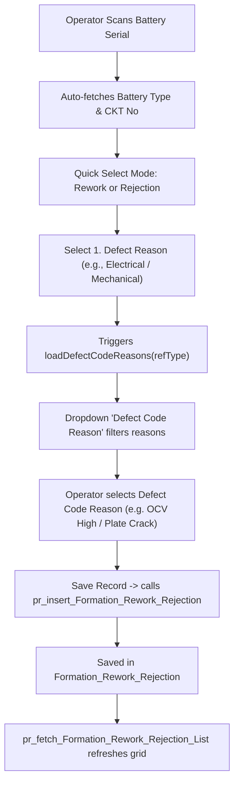

# MVRLA Formation - Defect Code Reason Database & Label Changes Specification

**Target Page:** [Transaction / Rework & Rejection](http://localhost:19450/Transaction/Rework_Rejection)  
**Database:** `MVRLA_Formation`  
**Reference SQL Scripts:** 
- [MVRLA_Fix_Rework_Rejection_And_Report.sql](file:///d:/office/MVRLA_Formation/MVRLA_Formation/MVRLA_Fix_Rework_Rejection_And_Report.sql)
- [MVRLA_ReworkRejection_Reason_Fix.sql](file:///d:/office/MVRLA_Formation/MVRLA_Formation/MVRLA_ReworkRejection_Reason_Fix.sql)
- [MVRLA_Defect_Reason_Type_Migration.sql](file:///d:/office/MVRLA_Formation/MVRLA_Formation/MVRLA_Defect_Reason_Type_Migration.sql)
- [MVRLA_Enhance_Rework_Rejection.sql](file:///d:/office/MVRLA_Formation/MVRLA_Formation/MVRLA_Enhance_Rework_Rejection.sql)

---

## 1. Summary of Changes

The **Defect Code Reason** feature enhances the Rework / Rejection entry workflow by mapping Reference Types (e.g. *Electrical, Mechanical, Quality, Pneumatic*) to specific Defect Reasons and capturing granular cell/plate parameters.

| Scope | Changes Implemented |
|---|---|
| **Table Schema (ALTER)** | Added `RGV_vDefectReasonType` to `ReferenceGroup_Value`. Added `FRR_DefectReasonType`, `FRR_DefectReason`, and 11 cell/plate detail columns to `Formation_Rework_Rejection`. |
| **Stored Procedures** | Altered `pr_fetch_Rework_Rejection_Reasons`, `pr_insert_Formation_Rework_Rejection`, `pr_fetch_Formation_Rework_Rejection_List`, and `pr_fetch_Rework_Rejection_Report`. Created `pr_fetch_Defect_Reason_Types` & `pr_fetch_Defect_Reasons_ByType`. |
| **Label Changes (UI)** | Updated field label from **`Reason`** to **`Defect Reason`**, added **`Defect Code Reason`** label, updated grid column headers from **`Reason`** to **`Defect Reason`** & **`Defect Code Reason`**, dynamic toast validation, and dynamic dropdown placeholders. |

---

## 2. Database Table Schema Changes (`ALTER TABLE`)

### 2.1. Table: `ReferenceGroup_Value`
Adds the mapping column so that reasons can be linked to a Reference Type (e.g. `Electrical`, `Mechanical`, `Quality`).

```sql
IF NOT EXISTS (
    SELECT 1 FROM INFORMATION_SCHEMA.COLUMNS 
    WHERE TABLE_NAME = 'ReferenceGroup_Value' 
      AND COLUMN_NAME = 'RGV_vDefectReasonType'
)
BEGIN
    ALTER TABLE ReferenceGroup_Value ADD RGV_vDefectReasonType VARCHAR(100) NULL;
    PRINT 'Added RGV_vDefectReasonType to ReferenceGroup_Value.';
END
GO
```

### 2.2. Table: `Formation_Rework_Rejection`
Adds the defect reason fields and cell/plate details.

```sql
-- Defect Reason Columns
IF NOT EXISTS (SELECT 1 FROM sys.columns WHERE object_id = OBJECT_ID('Formation_Rework_Rejection') AND name = 'FRR_DefectReasonType')
    ALTER TABLE Formation_Rework_Rejection ADD FRR_DefectReasonType VARCHAR(100) NULL;

IF NOT EXISTS (SELECT 1 FROM sys.columns WHERE object_id = OBJECT_ID('Formation_Rework_Rejection') AND name = 'FRR_DefectReason')
    ALTER TABLE Formation_Rework_Rejection ADD FRR_DefectReason VARCHAR(500) NULL;

-- Cell & Plate Detail Columns
IF NOT EXISTS (SELECT 1 FROM sys.columns WHERE object_id = OBJECT_ID('Formation_Rework_Rejection') AND name = 'FRR_Cell1')
    ALTER TABLE Formation_Rework_Rejection ADD FRR_Cell1 VARCHAR(50) NULL;
IF NOT EXISTS (SELECT 1 FROM sys.columns WHERE object_id = OBJECT_ID('Formation_Rework_Rejection') AND name = 'FRR_Cell2')
    ALTER TABLE Formation_Rework_Rejection ADD FRR_Cell2 VARCHAR(50) NULL;
IF NOT EXISTS (SELECT 1 FROM sys.columns WHERE object_id = OBJECT_ID('Formation_Rework_Rejection') AND name = 'FRR_Cell3')
    ALTER TABLE Formation_Rework_Rejection ADD FRR_Cell3 VARCHAR(50) NULL;
IF NOT EXISTS (SELECT 1 FROM sys.columns WHERE object_id = OBJECT_ID('Formation_Rework_Rejection') AND name = 'FRR_Cell4')
    ALTER TABLE Formation_Rework_Rejection ADD FRR_Cell4 VARCHAR(50) NULL;
IF NOT EXISTS (SELECT 1 FROM sys.columns WHERE object_id = OBJECT_ID('Formation_Rework_Rejection') AND name = 'FRR_Cell5')
    ALTER TABLE Formation_Rework_Rejection ADD FRR_Cell5 VARCHAR(50) NULL;
IF NOT EXISTS (SELECT 1 FROM sys.columns WHERE object_id = OBJECT_ID('Formation_Rework_Rejection') AND name = 'FRR_Cell6')
    ALTER TABLE Formation_Rework_Rejection ADD FRR_Cell6 VARCHAR(50) NULL;
IF NOT EXISTS (SELECT 1 FROM sys.columns WHERE object_id = OBJECT_ID('Formation_Rework_Rejection') AND name = 'FRR_DefectCell')
    ALTER TABLE Formation_Rework_Rejection ADD FRR_DefectCell VARCHAR(50) NULL;
IF NOT EXISTS (SELECT 1 FROM sys.columns WHERE object_id = OBJECT_ID('Formation_Rework_Rejection') AND name = 'FRR_OCV')
    ALTER TABLE Formation_Rework_Rejection ADD FRR_OCV VARCHAR(50) NULL;
IF NOT EXISTS (SELECT 1 FROM sys.columns WHERE object_id = OBJECT_ID('Formation_Rework_Rejection') AND name = 'FRR_PlateNo')
    ALTER TABLE Formation_Rework_Rejection ADD FRR_PlateNo VARCHAR(50) NULL;
IF NOT EXISTS (SELECT 1 FROM sys.columns WHERE object_id = OBJECT_ID('Formation_Rework_Rejection') AND name = 'FRR_Location')
    ALTER TABLE Formation_Rework_Rejection ADD FRR_Location VARCHAR(50) NULL;
IF NOT EXISTS (SELECT 1 FROM sys.columns WHERE object_id = OBJECT_ID('Formation_Rework_Rejection') AND name = 'FRR_PlateType')
    ALTER TABLE Formation_Rework_Rejection ADD FRR_PlateType VARCHAR(50) NULL;
GO
```

---

## 3. Reference Groups & Seed Queries

### 3.1. Reference Groups Registration
Defect Reason Type (`DRT`) and Defect Reason (`DR`):

```sql
IF NOT EXISTS (SELECT 1 FROM Reference_Group WHERE RG_vDescription = 'Defect Reason Type')
BEGIN
    DECLARE @NewRGID INT = (SELECT ISNULL(MAX(RG_iID), 0) + 1 FROM Reference_Group);
    INSERT INTO Reference_Group (RG_iID, RG_vCode, RG_vDescription, RG_vStatus)
    VALUES (@NewRGID, 'DRT', 'Defect Reason Type', 'A');
END

IF NOT EXISTS (SELECT 1 FROM Reference_Group WHERE RG_vDescription = 'Defect Reason')
BEGIN
    DECLARE @NewRGID2 INT = (SELECT ISNULL(MAX(RG_iID), 0) + 1 FROM Reference_Group);
    INSERT INTO Reference_Group (RG_iID, RG_vCode, RG_vDescription, RG_vStatus)
    VALUES (@NewRGID2, 'DR', 'Defect Reason', 'A');
END
GO
```

### 3.2. Reference Group Values Seed Data
Configures categories (`Electrical`, `Mechanical`, `Quality`) and reason mapping:

```sql
DECLARE @DRT_ID INT = (SELECT RG_iID FROM Reference_Group WHERE RG_vDescription = 'Defect Reason Type');
DECLARE @DR_ID INT  = (SELECT RG_iID FROM Reference_Group WHERE RG_vDescription = 'Defect Reason');
IF @DR_ID IS NULL SET @DR_ID = 17;

-- Types: Electrical, Mechanical, Quality
-- Reasons:
-- Electrical: OCV High, OCV Low, Cell Voltage Issue
-- Mechanical: Plate Crack, Plate Damage
-- Quality: Wrong Plate
UPDATE ReferenceGroup_Value 
SET RGV_vDefectReasonType = 'Electrical' 
WHERE RGV_vDesciption IN ('OCV High', 'OCV Low', 'Cell Voltage Issue');

UPDATE ReferenceGroup_Value 
SET RGV_vDefectReasonType = 'Mechanical' 
WHERE RGV_vDesciption IN ('Plate Crack', 'Plate Damage');

UPDATE ReferenceGroup_Value 
SET RGV_vDefectReasonType = 'Quality' 
WHERE RGV_vDesciption IN ('Wrong Plate');
GO
```

---

## 4. Stored Procedure Changes

### 4.1. `pr_fetch_Rework_Rejection_Reasons` (ALTER)
**Purpose:** Fetches defect reasons filtered by `@Type_ID` (e.g. 12 = Rework, 13 = Rejection, 17 = Defect Reason) and `@ReferenceType` (e.g. `Electrical`, `Mechanical`, `Quality`).

```sql
CREATE OR ALTER PROCEDURE pr_fetch_Rework_Rejection_Reasons
    @Type_ID       VARCHAR(100) = NULL,
    @ReferenceType VARCHAR(100) = NULL
AS
BEGIN
    SET NOCOUNT ON;

    SET @Type_ID = NULLIF(LTRIM(RTRIM(@Type_ID)), '');
    SET @ReferenceType = NULLIF(LTRIM(RTRIM(@ReferenceType)), '');

    IF (@Type_ID = 'ALL') SET @Type_ID = NULL;
    IF (@ReferenceType = 'ALL') SET @ReferenceType = NULL;

    -- Route single ReferenceType passed in @Type_ID to Defect Reasons (17)
    IF (@ReferenceType IS NULL AND @Type_ID IS NOT NULL
        AND EXISTS (
            SELECT 1 FROM ReferenceGroup_Value 
            WHERE RGV_vStatus = 'A' 
              AND LTRIM(RTRIM(RGV_vDefectReasonType)) = @Type_ID
        )
        AND @Type_ID NOT IN ('12', '13', 'Rework', 'Rejection')
    )
    BEGIN
        SET @ReferenceType = @Type_ID;
        SET @Type_ID = '17';
    END

    DECLARE @ParsedID INT = TRY_CAST(@Type_ID AS INT);

    SELECT DISTINCT
        v.RGV_iID,
        v.RGV_vDesciption,
        v.RGV_vCode,
        v.RGV_iRG_ID,
        ISNULL(NULLIF(LTRIM(RTRIM(v.RGV_vDefectReasonType)), ''), g.RG_vDescription) AS Reference_Type,
        ISNULL(v.RGV_vDefectReasonType, '') AS DefectReasonType
    FROM ReferenceGroup_Value v
    INNER JOIN Reference_Group g ON v.RGV_iRG_ID = g.RG_iID
    WHERE v.RGV_vStatus = 'A'
      AND g.RG_vStatus  = 'A'
      AND (
          @ReferenceType IS NULL
          OR LTRIM(RTRIM(v.RGV_vDefectReasonType)) = @ReferenceType
          OR LTRIM(RTRIM(g.RG_vDescription)) = @ReferenceType
          OR LTRIM(RTRIM(g.RG_vCode)) = @ReferenceType
      )
      AND (
          (@ParsedID IS NOT NULL AND v.RGV_iRG_ID = @ParsedID)
          OR (@ParsedID IS NULL AND @Type_ID IS NOT NULL
              AND (g.RG_vCode = @Type_ID OR g.RG_vDescription = @Type_ID))
          OR (@Type_ID IS NULL AND @ReferenceType IS NOT NULL
              AND (v.RGV_iRG_ID = 17 OR LTRIM(RTRIM(v.RGV_vDefectReasonType)) = @ReferenceType))
          OR (@Type_ID IS NULL AND @ReferenceType IS NULL
              AND v.RGV_iRG_ID IN (12, 13, 17))
      )
    ORDER BY v.RGV_vDesciption ASC;
END;
GO
```

---

### 4.2. `pr_insert_Formation_Rework_Rejection` (ALTER)
**Purpose:** Inserts both primary reason (`FRR_Reason`) and the selected Defect Code Reason (`FRR_DefectReason`), along with cell/plate parameters.

```sql
CREATE OR ALTER PROCEDURE pr_insert_Formation_Rework_Rejection
    @FRR_Formation_ID       INT = 68,
    @FRR_Type_ID            INT,
    @FRR_Type_Name          VARCHAR(50),
    @FRR_Reason             VARCHAR(500),
    @FRR_Employee_ID        INT,
    @FRR_Employee_Name      VARCHAR(100) = NULL,
    @FRR_Created_By         VARCHAR(50)  = 'System',
    @FRR_QRCode             VARCHAR(50)  = NULL,
    @FRR_BatteryType        VARCHAR(100) = NULL,
    @FRR_CKTNo              VARCHAR(50)  = NULL,
    @FRR_Cell1              VARCHAR(50)  = NULL,
    @FRR_Cell2              VARCHAR(50)  = NULL,
    @FRR_Cell3              VARCHAR(50)  = NULL,
    @FRR_Cell4              VARCHAR(50)  = NULL,
    @FRR_Cell5              VARCHAR(50)  = NULL,
    @FRR_Cell6              VARCHAR(50)  = NULL,
    @FRR_DefectCell         VARCHAR(50)  = NULL,
    @FRR_OCV                VARCHAR(50)  = NULL,
    @FRR_PlateNo            VARCHAR(50)  = NULL,
    @FRR_Location           VARCHAR(50)  = NULL,
    @FRR_PlateType          VARCHAR(50)  = NULL,
    @FRR_DefectReasonType   VARCHAR(100) = NULL,
    @FRR_DefectReason       VARCHAR(500) = NULL
AS
BEGIN
    SET NOCOUNT ON;
    
    IF (@FRR_Employee_Name IS NULL OR @FRR_Employee_Name = '')
    BEGIN
        SELECT @FRR_Employee_Name = EM_Employee_Name 
        FROM Employee_Master 
        WHERE EM_ID = @FRR_Employee_ID;
    END

    IF (@FRR_Type_Name IS NULL OR @FRR_Type_Name = '')
    BEGIN
        SELECT @FRR_Type_Name = RG_vDescription 
        FROM Reference_Group 
        WHERE RG_iID = @FRR_Type_ID;
    END

    IF (@FRR_Reason IS NULL OR @FRR_Reason = '')
        SET @FRR_Reason = @FRR_DefectReason;
    IF (@FRR_DefectReason IS NULL OR @FRR_DefectReason = '')
        SET @FRR_DefectReason = @FRR_Reason;

    INSERT INTO Formation_Rework_Rejection (
        FRR_Formation_ID, FRR_Type_ID, FRR_Type_Name, FRR_Reason,
        FRR_Employee_ID, FRR_Employee_Name, FRR_Created_By, FRR_Created_Date,
        FRR_Status, FRR_QRCode, FRR_BatteryType, FRR_CKTNo,
        FRR_Cell1, FRR_Cell2, FRR_Cell3, FRR_Cell4, FRR_Cell5, FRR_Cell6,
        FRR_DefectCell, FRR_OCV, FRR_PlateNo, FRR_Location, FRR_PlateType,
        FRR_DefectReasonType, FRR_DefectReason
    )
    VALUES (
        @FRR_Formation_ID, @FRR_Type_ID, @FRR_Type_Name, @FRR_Reason,
        @FRR_Employee_ID, @FRR_Employee_Name, @FRR_Created_By, GETDATE(),
        'A', @FRR_QRCode, @FRR_BatteryType, @FRR_CKTNo,
        @FRR_Cell1, @FRR_Cell2, @FRR_Cell3, @FRR_Cell4, @FRR_Cell5, @FRR_Cell6,
        @FRR_DefectCell, @FRR_OCV, @FRR_PlateNo, @FRR_Location, @FRR_PlateType,
        @FRR_DefectReasonType, @FRR_DefectReason
    );
END;
GO
```

---

### 4.3. `pr_fetch_Formation_Rework_Rejection_List` (ALTER)
**Purpose:** Returns all columns including `FRR_DefectReason`, `FRR_DefectReasonType`, and cell/plate details for the grid on the entry page.

```sql
CREATE OR ALTER PROCEDURE pr_fetch_Formation_Rework_Rejection_List
AS
BEGIN
    SET NOCOUNT ON;
    SELECT 
        ROW_NUMBER() OVER(ORDER BY FRR_ID DESC) AS [SNo],
        FRR_ID,
        ISNULL(FRR_QRCode, '') AS FRR_QRCode,
        ISNULL(FRR_BatteryType, '') AS FRR_BatteryType,
        ISNULL(FRR_CKTNo, '') AS FRR_CKTNo,
        FRR_Type_Name,
        FRR_Reason,
        ISNULL(FRR_DefectReasonType, '') AS FRR_DefectReasonType,
        ISNULL(FRR_DefectReason, ISNULL(FRR_Reason, '')) AS FRR_DefectReason,
        FRR_Employee_Name,
        FRR_Created_By,
        CONVERT(VARCHAR, FRR_Created_Date, 103) + ' ' + CONVERT(VARCHAR(5), FRR_Created_Date, 108) AS FRR_Created_Date,
        FRR_Status,
        ISNULL(FRR_Cell1, '') AS FRR_Cell1,
        ISNULL(FRR_Cell2, '') AS FRR_Cell2,
        ISNULL(FRR_Cell3, '') AS FRR_Cell3,
        ISNULL(FRR_Cell4, '') AS FRR_Cell4,
        ISNULL(FRR_Cell5, '') AS FRR_Cell5,
        ISNULL(FRR_Cell6, '') AS FRR_Cell6,
        ISNULL(FRR_DefectCell, '') AS FRR_DefectCell,
        ISNULL(FRR_OCV, '') AS FRR_OCV,
        ISNULL(FRR_PlateNo, '') AS FRR_PlateNo,
        ISNULL(FRR_Location, '') AS FRR_Location,
        ISNULL(FRR_PlateType, '') AS FRR_PlateType
    FROM Formation_Rework_Rejection
    WHERE FRR_Status = 'A'
    ORDER BY FRR_ID DESC;
END;
GO
```

---

### 4.4. `pr_fetch_Rework_Rejection_Report` (ALTER)
**Purpose:** Provides the data for the Reports page (`Reports/Rework_Rejection`) with date filtering and QR code metadata fallback.

```sql
CREATE OR ALTER PROCEDURE pr_fetch_Rework_Rejection_Report
    @Type VARCHAR(50) = 'All',
    @FromDate VARCHAR(20) = NULL,
    @ToDate VARCHAR(20) = NULL
AS
BEGIN
    SET NOCOUNT ON;

    SET @Type = NULLIF(LTRIM(RTRIM(@Type)), '');
    IF (@Type = 'All') SET @Type = NULL;

    SET @FromDate = NULLIF(LTRIM(RTRIM(@FromDate)), '');
    SET @ToDate = NULLIF(LTRIM(RTRIM(@ToDate)), '');

    DECLARE @ParsedFrom DATE = NULL;
    DECLARE @ParsedTo DATE = NULL;

    IF (@FromDate IS NOT NULL)
        SET @ParsedFrom = CASE WHEN ISDATE(@FromDate) = 1 THEN CAST(@FromDate AS DATE) ELSE TRY_CAST(@FromDate AS DATE) END;

    IF (@ToDate IS NOT NULL)
        SET @ParsedTo = CASE WHEN ISDATE(@ToDate) = 1 THEN CAST(@ToDate AS DATE) ELSE TRY_CAST(@ToDate AS DATE) END;

    SELECT 
        ROW_NUMBER() OVER(ORDER BY R.FRR_ID DESC) AS [SNo],
        R.FRR_ID,
        'F' + RIGHT('000' + CAST(R.FRR_ID AS VARCHAR(10)), 3) AS [Formation_ID],
        ISNULL(R.FRR_QRCode, '') AS [FRR_QRCode],
        ISNULL(NULLIF(R.FRR_BatteryType, ''), ISNULL(M.mv_BatteryType, '')) AS [FRR_BatteryType],
        ISNULL(NULLIF(R.FRR_CKTNo, ''), ISNULL(M.mv_CKTNo, '')) AS [FRR_CKTNo],
        R.FRR_Formation_ID,
        R.FRR_Type_ID,
        R.FRR_Type_Name,
        R.FRR_Reason,
        ISNULL(R.FRR_DefectReasonType, '') AS [FRR_DefectReasonType],
        ISNULL(R.FRR_DefectReason, ISNULL(R.FRR_Reason, '')) AS [FRR_DefectReason],
        R.FRR_Employee_ID,
        R.FRR_Employee_Name,
        R.FRR_Created_By,
        CONVERT(VARCHAR, R.FRR_Created_Date, 103) + ' ' + CONVERT(VARCHAR(5), R.FRR_Created_Date, 108) AS FRR_Created_Date,
        R.FRR_Status,
        ISNULL(R.FRR_Cell1, '') AS [FRR_Cell1],
        ISNULL(R.FRR_Cell2, '') AS [FRR_Cell2],
        ISNULL(R.FRR_Cell3, '') AS [FRR_Cell3],
        ISNULL(R.FRR_Cell4, '') AS [FRR_Cell4],
        ISNULL(R.FRR_Cell5, '') AS [FRR_Cell5],
        ISNULL(R.FRR_Cell6, '') AS [FRR_Cell6],
        ISNULL(R.FRR_DefectCell, '') AS [FRR_DefectCell],
        ISNULL(R.FRR_OCV, '') AS [FRR_OCV],
        ISNULL(R.FRR_PlateNo, '') AS [FRR_PlateNo],
        ISNULL(R.FRR_Location, '') AS [FRR_Location],
        ISNULL(R.FRR_PlateType, '') AS [FRR_PlateType]
    FROM Formation_Rework_Rejection R
    OUTER APPLY (
        SELECT TOP 1 mv_BatteryType, mv_CKTNo
        FROM MVRLA
        WHERE mv_QRCode = R.FRR_QRCode
        ORDER BY mv_ID DESC
    ) M
    WHERE R.FRR_Status = 'A'
      AND (@Type IS NULL OR @Type = '' OR @Type = 'All' OR R.FRR_Type_Name = @Type OR CAST(R.FRR_Type_ID AS VARCHAR(50)) = @Type)
      AND (@ParsedFrom IS NULL OR CAST(R.FRR_Created_Date AS DATE) >= @ParsedFrom)
      AND (@ParsedTo IS NULL OR CAST(R.FRR_Created_Date AS DATE) <= @ParsedTo)
    ORDER BY R.FRR_ID DESC;
END;
GO
```

---

## 5. UI Label & Text Changes (Latest Updates)

Below are all the label and text modifications in the view file:  
`d:\office\MVRLA_Formation\MVRLA_Formation\SBLT2\Views\Transaction\Rework_Rejection.cshtml`

### 5.1. Form Control Labels
| Element | Old Label / Placeholder | New Updated Label / Placeholder | Purpose |
|---|---|---|---|
| **Field 1 (`#ddlReason`)** | `<label>* 1. Reason</label>` | `<label><span class="required-star">*</span> 1. Defect Reason</label>` | Clarifies that this is the main defect category/reason. |
| **New Field (`#ddlDefectCodeReason`)** | *(New field)* | `<label>Defect Code Reason</label>` | Explicit label for the mapped defect reason dropdown. |
| **Dropdown Placeholder** | `"Select Defect Code Reason"` | Dynamic: `"Select " + refType + " Reason"` (e.g. `Select Electrical Reason`, `Select Mechanical Reason`) | Guides operator based on selected reference type. |
| **Validation Toast** | `"Please Select Reason"` | Dynamic: `"Please Select " + reasonLabel + " Reason"` (e.g. `Please Select Rework Reason`, `Please Select Rejection Reason`) | Accurately indicates whether Rework or Rejection reason was missing. |

### 5.2. JQXGrid Table Header Labels
| Column Datafield | Old Column Header Text | New Updated Column Header Text | Width |
|---|---|---|---|
| `FRR_Reason` | `'Reason'` | **`'Defect Reason'`** | 140px |
| `FRR_DefectReason` | *(Not present)* | **`'Defect Code Reason'`** | 150px |
| `FRR_DefectCell` | *(Not present)* | **`'Defect Cell'`** | 80px |
| `FRR_OCV` | *(Not present)* | **`'OCV'`** | 75px |
| `FRR_PlateNo` | *(Not present)* | **`'Plate No'`** | 75px |
| `FRR_Location` | *(Not present)* | **`'Location'`** | 75px |
| `FRR_PlateType` | *(Not present)* | **`'Plate Type'`** | 110px |
| `FRR_Cell1` .. `FRR_Cell6` | *(Not present)* | **`'Cell 1'` .. `'Cell 6'`** | 60px each |

### 5.3. Reports Page Header Labels (`Views/Reports/Rework_Rejection.cshtml`)
- Changed column header `'Reason'` to **`'Defect Reason'`** (`FRR_Reason`).
- Added column header **`'Defect Code Reason'`** (`FRR_DefectReason`).
- Added cell/plate column headers to align identically with the transaction grid and export.

---

## 6. How the Defect Code Reason Logic Operates


